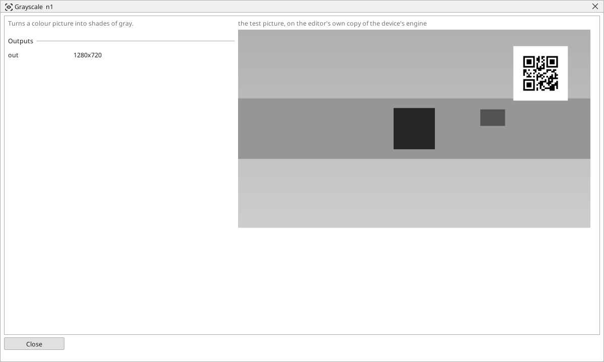

<!-- AUTOMATICALLY GENERATED from schema/visu-vision.yaml (tools/gen_vision.py) -->

# Grayscale

**Colour** · in the trade: *grayscale conversion* · in a project file: `gray`

Turns a colour picture into shades of gray.

{: .sb-center}

Turns a colour picture into shades of gray. Most measuring and finding blocks work on brightness alone and do this themselves when they get a colour picture; put a Grayscale in front of them when several blocks share the gray picture (it is computed once) or when the gray picture itself should be shown on a screen.

To keep ONE colour's information rather than the brightness of all three, use [One channel](vision-channel.md).

## Typical uses

- one gray picture shared by several blocks
- a gray preview on a screen

## Inputs

| Input | Type | Meaning |
|:---|:---:|:---|
| `src` | picture | a colour picture |

## Outputs

| Output | Type | Meaning |
|:---|:---:|:---|
| `out` | picture | the same picture in shades of gray |

A number or a yes/no output goes into a variable of the PLC program (right-click the block on the Vision page, *Result ... into*); a text output into a STRING variable; a picture or a list of objects into the next block.

## Settings

The block has no settings.

---

Every block: [Vision blocks](vision-blocks.md) · how a program is drawn and what its window shows: [Vision](vision.md) · the cameras: [Cameras](cameras.md)
