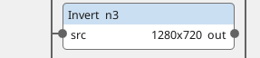
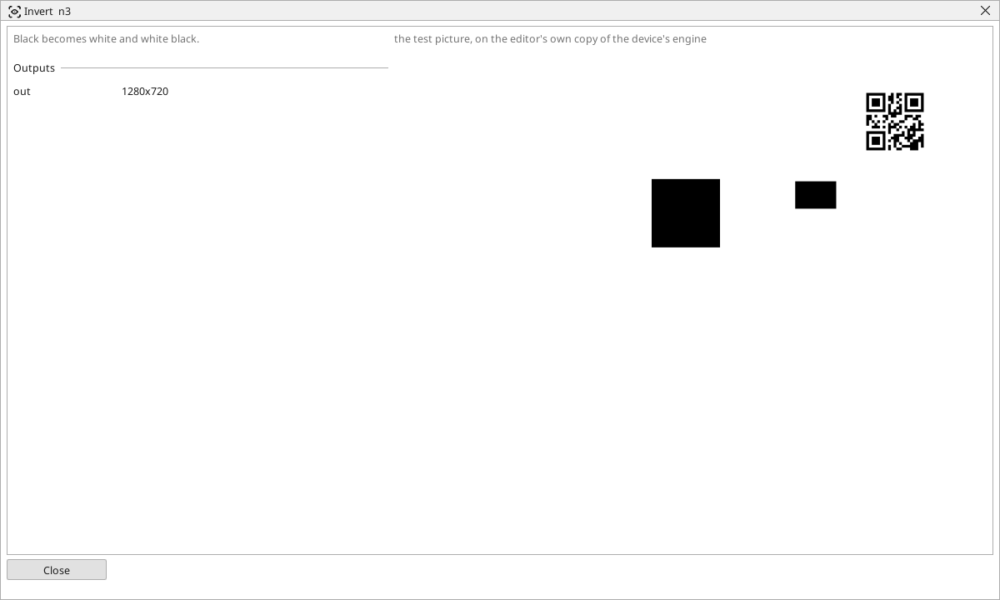

<!-- AUTOMATICALLY GENERATED from schema/visu-vision.yaml (tools/gen_vision.py) -->

# Invert

**Colour** · in the trade: *image inversion* · in a project file: `invert`

Black becomes white and white black.

{: .sb-center}

{: .sb-center}

## Where it runs

| Linux runtime, 64-bit | Linux runtime, 32-bit ARM | ESP32 boards | STM32 |
|:---:|:---:|:---:|:---:|
| yes | - | - | - |

**Needs:** a camera of the project (a USB camera or a stream address).

## Description

Black becomes white and white black; in a gray picture every shade is reversed. The shape-finding blocks look for WHITE areas on black - after a threshold that made the part black and the belt white, an Invert turns the part into the thing that is found.

## Typical uses

- a dark part made the white shape the finders look for
- a mask turned inside out

## Inputs

| Input | Type | Meaning |
|:---|:---:|:---|
| `src` | picture | the picture to reverse |

## Outputs

| Output | Type | Meaning |
|:---|:---:|:---|
| `out` | picture | the reversed picture |

A number or a yes/no output goes into a variable of the PLC program (right-click the block on the Vision page, *Result ... into*); a text output into a STRING variable; a picture or a list of objects into the next block.

## Settings

The block has no settings.

---

Every block: [Vision blocks](vision-blocks.md) · how a program is drawn and what its window shows: [Vision](vision.md) · the cameras: [Cameras](cameras.md)
