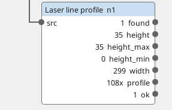
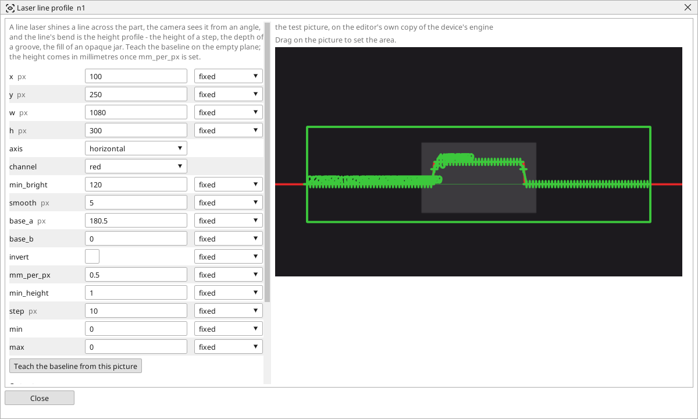

<!-- AUTOMATICALLY GENERATED from schema/visu-vision.yaml (tools/gen_vision.py) -->

# Laser line profile

**Measurements** · in the trade: *laser triangulation, 2D profile sensor* · in a project file: `laser_line`

A line laser shines a line across the part, the camera sees it from an angle, and the line's bend is the height profile - the height of a step, the depth of a groove, the fill of an opaque jar. Teach the baseline on the empty plane; the height comes in millimetres once mm_per_px is set.

{: .sb-center}

{: .sb-center}

## Where it runs

| Linux runtime, 64-bit | Linux runtime, 32-bit ARM | ESP32 boards | STM32 |
|:---:|:---:|:---:|:---:|
| yes | - | - | - |

**Needs:** a camera of the project (a USB camera or a stream address).

## Description

A height profile from a cheap line laser and the ordinary camera (laser triangulation). The laser shines a line across the part, the camera looks at it from an angle, and where the part is higher the line is shifted - the line's bend IS the height profile. The block finds the line's row in every column of the window (the brightest run in the laser's colour channel), subtracts the taught baseline and answers the *height* at the window's middle, its extremes, the *width* of what stands higher than `min_height`, and the whole profile as objects (one every `step` columns, the height in the object's r) for the geometry blocks.

Set the window across the line, pick the `channel` the laser is brightest in (red for a red laser), then with NOTHING under the laser press **Teach the baseline from this picture**: the line on the empty plane becomes the zero. Put a block of known height under the laser, read the *height* in pixels and type height / pixels into `mm_per_px`; from then on every height is in millimetres, and `min`/`max` make *ok* a tolerance check. `invert` is for a laser mounted on the other side, where the line moves down for a higher part. A black or a shiny part may swallow the line - lower `min_bright` or dim the ambient light.

## Typical uses

- the height of a step, the depth of a groove
- the fill of an opaque jar or a tray
- the presence and the height of a bead of glue or sealant

## Inputs

| Input | Type | Meaning |
|:---|:---:|:---|
| `src` | picture | the picture with the laser line |

## Outputs

| Output | Type | Meaning |
|:---|:---:|:---|
| `found` | yes/no | the line was found across the window |
| `height` | number | the height at the window's middle column (mm with mm_per_px, else px of shift) |
| `height_max` | number | the highest point of the profile |
| `height_min` | number | the lowest point of the profile |
| `width` | number | how many columns stand higher than min_height, in pixels along the line |
| `profile` | list of objects | an object every `step` columns, at the line's place, its height in r |
| `ok` | yes/no | the height lies between min and max |

A number or a yes/no output goes into a variable of the PLC program (right-click the block on the Vision page, *Result ... into*); a text output into a STRING variable; a picture or a list of objects into the next block.

## Settings

| Setting | Range | Default | Unit | Meaning |
|:---|:---:|:---:|:---:|:---|
| `x` | 0 .. 8192 | 0 | px | left edge of the window |
| `y` | 0 .. 8192 | 0 | px | top edge of the window |
| `w` | 1 .. 8192 | 640 | px | width |
| `h` | 1 .. 8192 | 200 | px | height - the whole range the line may bend in |
| `axis` | horizontal / vertical | horizontal |  | the line runs across the window (and bends up and down) or down it |
| `channel` | red / green / gray | red |  | the colour the laser is brightest in |
| `min_bright` | 1 .. 255 | 100 |  | a pixel darker than this is not the line |
| `smooth` | 1 .. 31 | 5 | px | columns averaged along the line |
| `base_a` | -8192 .. 8192 | 0 | px | the taught baseline - the line's row at the window's first column (Teach on the empty plane) |
| `base_b` | -10 .. 10 | 0 |  | the taught baseline's slope |
| `invert` | yes / no | no |  | the line moves DOWN when the part is higher (the laser sits on the other side) |
| `mm_per_px` | 0 .. 100 | 0 |  | millimetres of height per pixel of shift - measured once with a block of known height (0 = answer in pixels) |
| `min_height` | 0 .. 100000 | 1 |  | columns higher than this count into the width |
| `step` | 1 .. 100 | 10 | px | every so many columns one profile object |
| `min` | 0 .. 100000 | 0 |  | the height must be at least this (0 = no limit) |
| `max` | 0 .. 100000 | 0 |  | the height must be at most this (0 = no limit) |

Every number and yes/no setting can be read from a **variable** before each run instead of being fixed - pick it in the list beside the setting (the variable column of [the block's window](vision.md#the-blocks-window)). A text setting takes a STRING variable the same way.

## On the block's window

- **Drag on the picture** to set the area (`x`, `y`, `w`, `h`). The numbers follow and can still be typed.
- **Teach the baseline from this picture** - a button in the window: with the laser line on the empty plane (nothing under it) it fits the line and stores it in `base_a` and `base_b`.

---

Every block: [Vision blocks](vision-blocks.md) · how a program is drawn and what its window shows: [Vision](vision.md) · the cameras: [Cameras](cameras.md)
