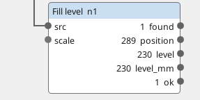
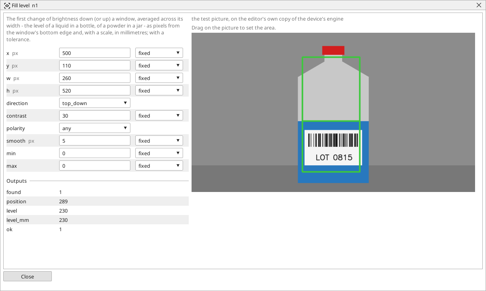

<!-- AUTOMATICALLY GENERATED from schema/visu-vision.yaml (tools/gen_vision.py) -->

# Fill level

**Measurements** · in the trade: *edge-based level detection, fill height gauging* · in a project file: `level`

The first change of brightness down (or up) a window, averaged across its width - the level of a liquid in a bottle, of a powder in a jar - as pixels from the window's bottom edge and, with a scale, in millimetres; with a tolerance.

{: .sb-center}

{: .sb-center}

## Where it runs

| Linux runtime, 64-bit | Linux runtime, 32-bit ARM | ESP32 boards | STM32 |
|:---:|:---:|:---:|:---:|
| yes | - | - | - |

**Needs:** a camera of the project (a USB camera or a stream address).

## Description

Measures a fill level: the first change of brightness going down a window (or up it), averaged across the window's width - the surface of a liquid in a bottle, of a powder in a jar, of a stack in a magazine. The answer is *position* (pixels from the edge the search started at) and *level* (pixels from the other edge - the bottom for a top-down search - which is the fill height a specification states); with a scale wired in, *level_mm* is the same in millimetres, and `min`/`max` make *ok* a tolerance check.

The window is dragged on the block's picture: as wide as the vessel's straight part, as tall as the whole range the level may lie in. `smooth` averages that many rows before the search - a rough or foaming surface wants more; `contrast` is the jump that counts as the surface and `polarity` whether a dark-over-light or a light-over-dark change counts - a clear liquid in a clear bottle is a faint edge, so lower the contrast and let a [Fixture](vision-fixture.md) keep the window on the bottle.

## Typical uses

- the fill level of bottles, jars, vials
- the height of a stack in a magazine or a bin
- the level of powder or granulate in a hopper

## Inputs

| Input | Type | Meaning |
|:---|:---:|:---|
| `src` | picture | the picture with the vessel |
| `scale` | number (optional) | millimetres per pixel from a Ruler or a Plane block (optional) |

## Outputs

| Output | Type | Meaning |
|:---|:---:|:---|
| `found` | yes/no | a surface was found in the window |
| `position` | number | the surface, pixels from the edge the search started at |
| `level` | number | the fill height: pixels from the window's other edge |
| `level_mm` | number | the fill height through the scale (px when none) |
| `ok` | yes/no | the level lies between min and max |

A number or a yes/no output goes into a variable of the PLC program (right-click the block on the Vision page, *Result ... into*); a text output into a STRING variable; a picture or a list of objects into the next block.

## Settings

| Setting | Range | Default | Unit | Meaning |
|:---|:---:|:---:|:---:|:---|
| `x` | 0 .. 8192 | 0 | px | left edge of the window |
| `y` | 0 .. 8192 | 0 | px | top edge of the window |
| `w` | 1 .. 8192 | 100 | px | width - the level is averaged across it |
| `h` | 1 .. 8192 | 300 | px | height - the whole range the level may lie in |
| `direction` | top_down / bottom_up | top_down |  | from which edge the search starts |
| `contrast` | 1 .. 255 | 40 |  | the jump in brightness that is the surface |
| `polarity` | any / dark_to_light / light_to_dark | any |  | which change counts |
| `smooth` | 1 .. 31 | 5 | px | rows averaged before the search - a rough surface wants more |
| `min` | 0 .. 100000 | 0 |  | the level must be at least this (0 = no limit) - mm with a scale |
| `max` | 0 .. 100000 | 0 |  | the level must be at most this (0 = no limit) |

Every number and yes/no setting can be read from a **variable** before each run instead of being fixed - pick it in the list beside the setting (the variable column of [the block's window](vision.md#the-blocks-window)). A text setting takes a STRING variable the same way.

## On the block's window

- **Drag on the picture** to set the area (`x`, `y`, `w`, `h`). The numbers follow and can still be typed.

## Used in

- Bottle check - a shipped example project

---

Every block: [Vision blocks](vision-blocks.md) · how a program is drawn and what its window shows: [Vision](vision.md) · the cameras: [Cameras](cameras.md)
