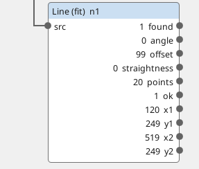
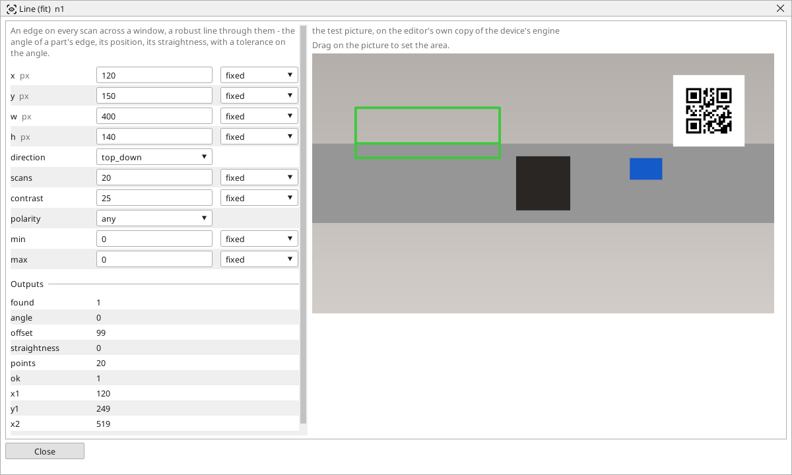

<!-- AUTOMATICALLY GENERATED from schema/visu-vision.yaml (tools/gen_vision.py) -->

# Line (fit)

**Measurements** · in the trade: *line gauge, robust line fit* · in a project file: `line_fit`

An edge on every scan across a window, a robust line through them - the angle of a part's edge, its position, its straightness, with a tolerance on the angle.

{: .sb-center}

{: .sb-center}

## Where it runs

| Linux runtime, 64-bit | Linux runtime, 32-bit ARM | ESP32 boards | STM32 |
|:---:|:---:|:---:|:---:|
| yes | - | - | - |

**Needs:** a camera of the project (a USB camera or a stream address).

## Description

Measures ONE straight edge precisely: `scans` scans run across the window in `direction` and each takes the first edge it meets, then a robust line is fitted through the edge points - the angle of a part's edge, its position, and *straightness* as how far the worst point lies off the line. The angle is in degrees, 0 along the picture's width; `min`/`max` make *ok* a tolerance check on it, and *x1*..*y2* give the line clipped to the window for the picture and for a [Distance of points](vision-points_dist.md).

The window is dragged on the block's picture across the edge; `contrast` and `polarity` as for the [Caliper](vision-caliper.md). Two Line (fit) blocks and an [Angle](vision-angle.md) block measure the angle between two edges - a bent flap, a skewed label, the squareness of a cut. For discovering where the lines in a picture are, [Find lines](vision-lines.md); for measuring one you know, this block.

## Typical uses

- the skew of a label or a print
- the angle of a cut edge, the squareness of a part
- the position of an edge against the belt's edge

## Inputs

| Input | Type | Meaning |
|:---|:---:|:---|
| `src` | picture | the picture with the edge |

## Outputs

| Output | Type | Meaning |
|:---|:---:|:---|
| `found` | yes/no | enough edge points for a line |
| `angle` | number | the line's angle, in degrees (0 = along the picture's width, -90..90) |
| `offset` | number | where the line crosses the window's middle scan, pixels from the scan's start |
| `straightness` | number | how far the worst kept point lies off the line, in pixels |
| `points` | number | how many edge points the fit kept |
| `ok` | yes/no | the angle lies between min and max |
| `x1` | number | the line's first end in the window (x) |
| `y1` | number | the line's first end (y) |
| `x2` | number | the line's second end (x) |
| `y2` | number | the line's second end (y) |

A number or a yes/no output goes into a variable of the PLC program (right-click the block on the Vision page, *Result ... into*); a text output into a STRING variable; a picture or a list of objects into the next block.

## Settings

| Setting | Range | Default | Unit | Meaning |
|:---|:---:|:---:|:---:|:---|
| `x` | 0 .. 8192 | 0 | px | left edge of the window |
| `y` | 0 .. 8192 | 0 | px | top edge of the window |
| `w` | 1 .. 8192 | 300 | px | width |
| `h` | 1 .. 8192 | 200 | px | height |
| `direction` | top_down / bottom_up / left_right / right_left | top_down |  | the scans run this way and take the first edge they meet |
| `scans` | 2 .. 200 | 20 |  | how many scans across the window |
| `contrast` | 1 .. 255 | 40 |  | the jump in brightness that is the edge |
| `polarity` | any / dark_to_light / light_to_dark | any |  | which edges count |
| `min` | -180 .. 180 | 0 |  | the angle must be at least this (min = max = 0 means no limit) |
| `max` | -180 .. 180 | 0 |  | the angle must be at most this |

Every number and yes/no setting can be read from a **variable** before each run instead of being fixed - pick it in the list beside the setting (the variable column of [the block's window](vision.md#the-blocks-window)). A text setting takes a STRING variable the same way.

## On the block's window

- **Drag on the picture** to set the area (`x`, `y`, `w`, `h`). The numbers follow and can still be typed.

---

Every block: [Vision blocks](vision-blocks.md) · how a program is drawn and what its window shows: [Vision](vision.md) · the cameras: [Cameras](cameras.md)
