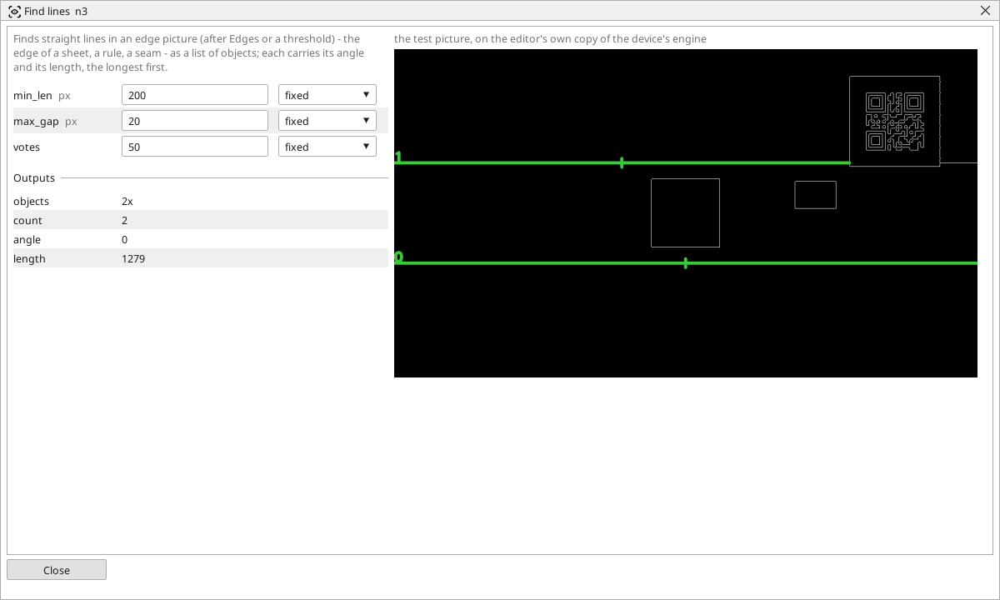

<!-- AUTOMATICALLY GENERATED from schema/visu-vision.yaml (tools/gen_vision.py) -->

# Find lines

**Finding objects** · in the trade: *Hough line transform* · in a project file: `lines`

Finds straight lines in an edge picture (after Edges or a threshold) - the edge of a sheet, a rule, a seam - as a list of objects; each carries its angle and its length, the longest first.

{: .sb-center}

Finds straight lines in an edge picture - the edge of a sheet, a seam, a rule, the sides of a plate - as a list of objects, each with its angle and its length, the longest first (the probabilistic Hough transform). Feed it the output of [Edges](vision-canny.md) or a thin threshold; on a gray picture it finds little.

`min_len` drops short lines, `max_gap` joins pieces of one line across small breaks, `votes` is how many edge points a line needs - raise it on a busy picture. *angle* and *length* are the longest line's. For the exact angle and position of ONE edge in a window, [Line (fit)](vision-line_fit.md) is more precise; Find lines is for discovering where the lines are.

## Typical uses

- the edges of a sheet discovered
- a seam or a rule found with its angle
- the sides of a plate before a measurement

## Inputs

| Input | Type | Meaning |
|:---|:---:|:---|
| `src` | picture | an edge picture (white lines on black) |

## Outputs

| Output | Type | Meaning |
|:---|:---:|:---|
| `objects` | list of objects | the lines, longest first - each an object with its angle and length |
| `count` | number | how many lines were found |
| `angle` | number | the longest line's angle, in degrees |
| `length` | number | the longest line's length, in pixels |

A number or a yes/no output goes into a variable of the PLC program (right-click the block on the Vision page, *Result ... into*); a text output into a STRING variable; a picture or a list of objects into the next block.

## Settings

| Setting | Range | Default | Unit | Meaning |
|:---|:---:|:---:|:---:|:---|
| `min_len` | 1 .. 8192 | 50 | px | shorter lines are not counted |
| `max_gap` | 0 .. 500 | 10 | px | a break shorter than this is still one line |
| `votes` | 1 .. 1000 | 50 |  | how many edge points a line needs |

Every number and yes/no setting can be read from a **variable** before each run instead of being fixed - pick it in the list beside the setting (the variable column of [the block's window](vision.md#the-blocks-window)). A text setting takes a STRING variable the same way.

---

Every block: [Vision blocks](vision-blocks.md) · how a program is drawn and what its window shows: [Vision](vision.md) · the cameras: [Cameras](cameras.md)
