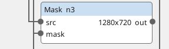
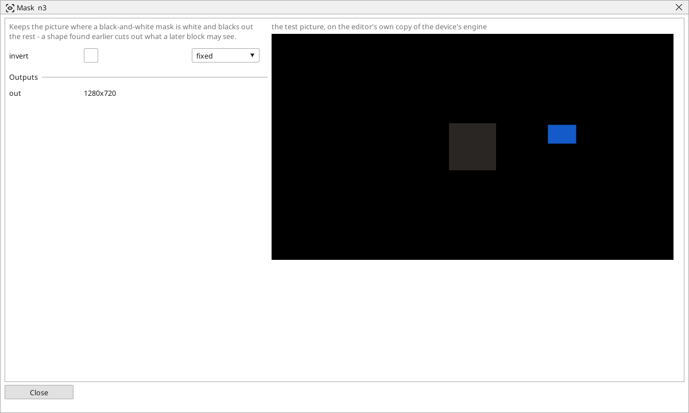

<!-- AUTOMATICALLY GENERATED from schema/visu-vision.yaml (tools/gen_vision.py) -->

# Mask

**Filters** · in the trade: *masking* · in a project file: `mask`

Keeps the picture where a black-and-white mask is white and blacks out the rest - a shape found earlier cuts out what a later block may see.

{: .sb-center}

{: .sb-center}

## Where it runs

| Linux runtime, 64-bit | Linux runtime, 32-bit ARM | ESP32 boards | STM32 |
|:---:|:---:|:---:|:---:|
| yes | - | - | - |

**Needs:** a camera of the project (a USB camera or a stream address).

## Description

Keeps the picture where a black-and-white mask is white and blacks out the rest. The mask usually comes from something found earlier in the program - a colour range, a found object filled, the inside of a found circle - and the blocks after the Mask see only what lies inside it: a code reader that reads the label only, a brightness measured on the part only, a caliper that cannot be fooled by the belt.

`invert` keeps the picture where the mask is black instead. The mask must have the same size as the picture; a mask made from a cropped picture does not fit the whole one.

## Typical uses

- a code read on the label only
- a brightness measured on the part only
- a caliper that cannot be fooled by the belt

## Inputs

| Input | Type | Meaning |
|:---|:---:|:---|
| `src` | picture | the picture to cut out of, colour or gray |
| `mask` | picture | black and white, the same size: white where the picture is kept |

## Outputs

| Output | Type | Meaning |
|:---|:---:|:---|
| `out` | picture | the picture inside the mask, black elsewhere |

A number or a yes/no output goes into a variable of the PLC program (right-click the block on the Vision page, *Result ... into*); a text output into a STRING variable; a picture or a list of objects into the next block.

## Settings

| Setting | Range | Default | Unit | Meaning |
|:---|:---:|:---:|:---:|:---|
| `invert` | yes / no | no |  | keep where the mask is black instead |

Every number and yes/no setting can be read from a **variable** before each run instead of being fixed - pick it in the list beside the setting (the variable column of [the block's window](vision.md#the-blocks-window)). A text setting takes a STRING variable the same way.

---

Every block: [Vision blocks](vision-blocks.md) · how a program is drawn and what its window shows: [Vision](vision.md) · the cameras: [Cameras](cameras.md)
