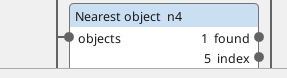
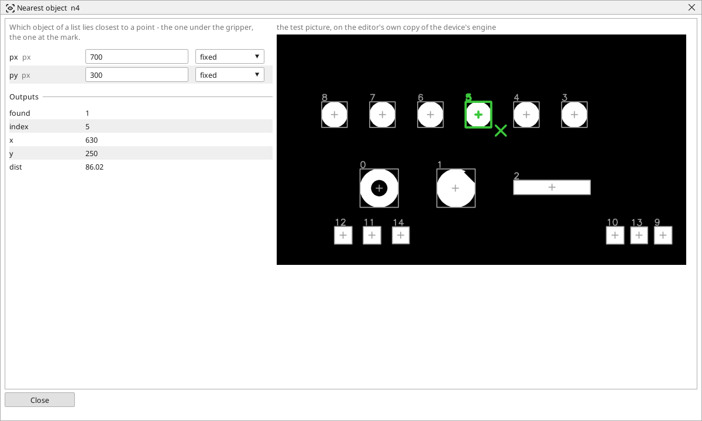

<!-- AUTOMATICALLY GENERATED from schema/visu-vision.yaml (tools/gen_vision.py) -->

# Nearest object

**Finding objects** · in the trade: *nearest blob to a point* · in a project file: `nearest`

Which object of a list lies closest to a point - the one under the gripper, the one at the mark.

{: .sb-center}

{: .sb-center}

## Where it runs

| Linux runtime, 64-bit | Linux runtime, 32-bit ARM | ESP32 boards | STM32 |
|:---:|:---:|:---:|:---:|
| yes | - | - | - |

**Needs:** a camera of the project (a USB camera or a stream address).

## Description

Finds which object of a list lies closest to a point - the one under the gripper, the one at the mark, the one nearest the exit of a feeder - and gives its number in the list, its centre and its distance from the point. The point is typed (`px`, `py`) and may come from a variable, so the PLC program can ask "what is nearest to where the arm is now".

Follow it with [Pick object](vision-pick.md) with the index it gives to get the rest of that object's numbers. *found* is off on an empty list.

## Typical uses

- the part under the gripper
- the part nearest the feeder's exit
- the object at a mark the PLC program names

## Inputs

| Input | Type | Meaning |
|:---|:---:|:---|
| `objects` | list of objects | the list to search |

## Outputs

| Output | Type | Meaning |
|:---|:---:|:---|
| `found` | yes/no | the list has at least one object |
| `index` | number | the nearest object's number in the list |
| `x` | number | the nearest object's centre, pixels from the left |
| `y` | number | the nearest object's centre, pixels from the top |
| `dist` | number | its distance from the point, in pixels |

A number or a yes/no output goes into a variable of the PLC program (right-click the block on the Vision page, *Result ... into*); a text output into a STRING variable; a picture or a list of objects into the next block.

## Settings

| Setting | Range | Default | Unit | Meaning |
|:---|:---:|:---:|:---:|:---|
| `px` | 0 .. 8192 | 320 | px | the point |
| `py` | 0 .. 8192 | 240 | px | the point |

Every number and yes/no setting can be read from a **variable** before each run instead of being fixed - pick it in the list beside the setting (the variable column of [the block's window](vision.md#the-blocks-window)). A text setting takes a STRING variable the same way.

---

Every block: [Vision blocks](vision-blocks.md) · how a program is drawn and what its window shows: [Vision](vision.md) · the cameras: [Cameras](cameras.md)
