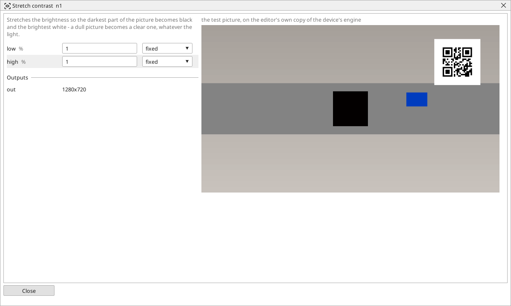

<!-- AUTOMATICALLY GENERATED from schema/visu-vision.yaml (tools/gen_vision.py) -->

# Stretch contrast

**Filters** · in the trade: *contrast stretching, intensity normalisation* · in a project file: `normalize`

Stretches the brightness so the darkest part of the picture becomes black and the brightest white - a dull picture becomes a clear one, whatever the light.

{: .sb-center}

Stretches the brightness so that the darkest part of the picture becomes black and the brightest white, with the shades between spread in proportion. A dull picture - a weak lamp, a camera's exposure set low - becomes a clear one, and a threshold after it keeps working when the light changes a little.

`low` and `high` say what share of the darkest and the brightest points is pushed all the way to black and white, so that a single specular glint or one dark hole does not set the whole range. One percent each is right for most pictures. In the shipped code-reading example the two are one variable the operator turns while watching the preview.

## Typical uses

- a dull picture made clear before a reader
- a threshold that holds when the lamp dims

## Inputs

| Input | Type | Meaning |
|:---|:---:|:---|
| `src` | picture | a dull picture |

## Outputs

| Output | Type | Meaning |
|:---|:---:|:---|
| `out` | picture | the picture stretched to the whole range |

A number or a yes/no output goes into a variable of the PLC program (right-click the block on the Vision page, *Result ... into*); a text output into a STRING variable; a picture or a list of objects into the next block.

## Settings

| Setting | Range | Default | Unit | Meaning |
|:---|:---:|:---:|:---:|:---|
| `low` | 0 .. 49 | 1 | % | share of the darkest points that count as black |
| `high` | 0 .. 49 | 1 | % | share of the brightest points that count as white |

Every number and yes/no setting can be read from a **variable** before each run instead of being fixed - pick it in the list beside the setting (the variable column of [the block's window](vision.md#the-blocks-window)). A text setting takes a STRING variable the same way.

## Used in

- The reTerminal with EtherCAT (the code reader) - a shipped example project

---

Every block: [Vision blocks](vision-blocks.md) · how a program is drawn and what its window shows: [Vision](vision.md) · the cameras: [Cameras](cameras.md)
