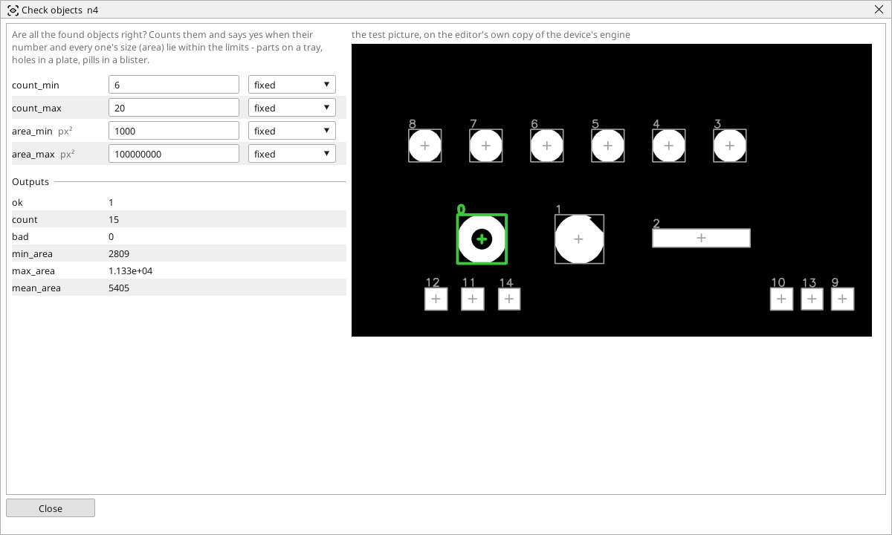

<!-- AUTOMATICALLY GENERATED from schema/visu-vision.yaml (tools/gen_vision.py) -->

# Check objects

**Finding objects** · in the trade: *count and size verification of blobs* · in a project file: `objcheck`

Are all the found objects right? Counts them and says yes when their number and every one's size (area) lie within the limits - parts on a tray, holes in a plate, pills in a blister.

{: .sb-center}

Judges a list of objects as a whole: are there as many as there should be, and is every one the right size? *ok* is on when the count lies between `count_min` and `count_max` and every object's area lies between `area_min` and `area_max`; *bad* counts the objects that do not. Parts on a tray, holes in a plate, pills in a blister, buttons on a panel - one block answers "complete and all alike".

The three areas (smallest, largest, mean) go into variables for a trend or a screen: a slowly growing mean area is a lamp dimming or a lens fogging long before the check fails. Feed it from [Find objects](vision-contours.md) after a clean threshold.

## Typical uses

- every nest of a tray filled
- every hole of a plate drilled
- every pill of a blister present and whole

## Inputs

| Input | Type | Meaning |
|:---|:---:|:---|
| `objects` | list of objects | the list of objects to judge |

## Outputs

| Output | Type | Meaning |
|:---|:---:|:---|
| `ok` | yes/no | the count and every area lie within the limits |
| `count` | number | how many objects there are |
| `bad` | number | how many objects fall outside the area limits |
| `min_area` | number | the smallest object's area, in pixels |
| `max_area` | number | the largest object's area, in pixels |
| `mean_area` | number | the mean area, in pixels |

A number or a yes/no output goes into a variable of the PLC program (right-click the block on the Vision page, *Result ... into*); a text output into a STRING variable; a picture or a list of objects into the next block.

## Settings

| Setting | Range | Default | Unit | Meaning |
|:---|:---:|:---:|:---:|:---|
| `count_min` | 0 .. 100000 | 1 |  | at least this many objects |
| `count_max` | 0 .. 100000 | 100000 |  | at most this many objects |
| `area_min` | 0 .. 100000000 | 0 | px² | an object smaller than this is bad |
| `area_max` | 0 .. 100000000 | 100000000 | px² | an object larger than this is bad |

Every number and yes/no setting can be read from a **variable** before each run instead of being fixed - pick it in the list beside the setting (the variable column of [the block's window](vision.md#the-blocks-window)). A text setting takes a STRING variable the same way.

---

Every block: [Vision blocks](vision-blocks.md) · how a program is drawn and what its window shows: [Vision](vision.md) · the cameras: [Cameras](cameras.md)
