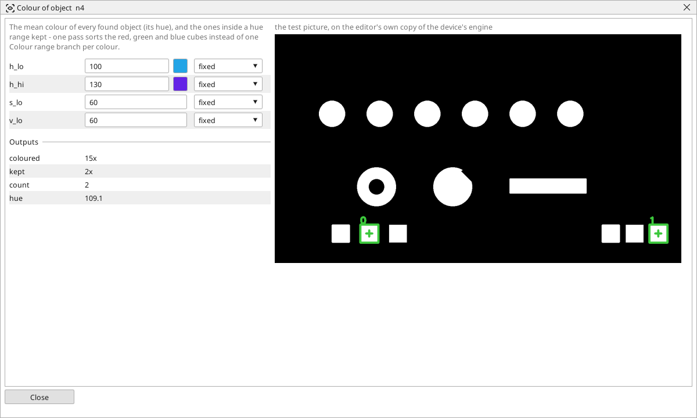

<!-- AUTOMATICALLY GENERATED from schema/visu-vision.yaml (tools/gen_vision.py) -->

# Colour of object

**Finding objects** · in the trade: *blob colour classification* · in a project file: `object_colour`

The mean colour of every found object (its hue), and the ones inside a hue range kept - one pass sorts the red, green and blue cubes instead of one Colour range branch per colour.

{: .sb-center}

Gives every object of a list its colour - the mean hue of the pixels inside it, read from the colour picture - and keeps the ones inside a hue range. One pass sorts the red, the green and the blue cubes on a tray: the list from [Find objects](vision-contours.md) goes in with the camera's colour picture, *coloured* comes out with a hue on every object, *kept* holds the ones between `h_lo` and `h_hi`, and *hue* is the first kept object's.

The hue runs 0..180 round the colour wheel (red 0, yellow 30, green 60, cyan 90, blue 120, magenta 150); a start above the end wraps round red. Objects grayer than `s_lo` or darker than `v_lo` get no colour and are never kept. One block per colour, all fed by the same list, is the usual shape for sorting.

## Typical uses

- red, green and blue cubes sorted in one pass
- the parts of one colour counted
- the hue of every part for a recipe check

## Inputs

| Input | Type | Meaning |
|:---|:---:|:---|
| `objects` | list of objects | the list of objects (found on a threshold of the same picture) |
| `src` | picture | the colour picture the objects lie in |

## Outputs

| Output | Type | Meaning |
|:---|:---:|:---|
| `coloured` | list of objects | every object, each with its hue |
| `kept` | list of objects | the objects whose hue lies inside the range |
| `count` | number | how many were kept |
| `hue` | number | the first kept object's hue (-1 when none) |

A number or a yes/no output goes into a variable of the PLC program (right-click the block on the Vision page, *Result ... into*); a text output into a STRING variable; a picture or a list of objects into the next block.

## Settings

| Setting | Range | Default | Unit | Meaning |
|:---|:---:|:---:|:---:|:---|
| `h_lo` | 0 .. 180 | 0 |  | the hue range's start (0..180 - red 0 |
| `h_hi` | 0 .. 180 | 180 |  | the hue range's end |
| `s_lo` | 0 .. 255 | 60 |  | greyer objects than this do not count |
| `v_lo` | 0 .. 255 | 60 |  | darker objects than this do not count |

Every number and yes/no setting can be read from a **variable** before each run instead of being fixed - pick it in the list beside the setting (the variable column of [the block's window](vision.md#the-blocks-window)). A text setting takes a STRING variable the same way.

---

Every block: [Vision blocks](vision-blocks.md) · how a program is drawn and what its window shows: [Vision](vision.md) · the cameras: [Cameras](cameras.md)
