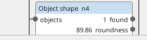
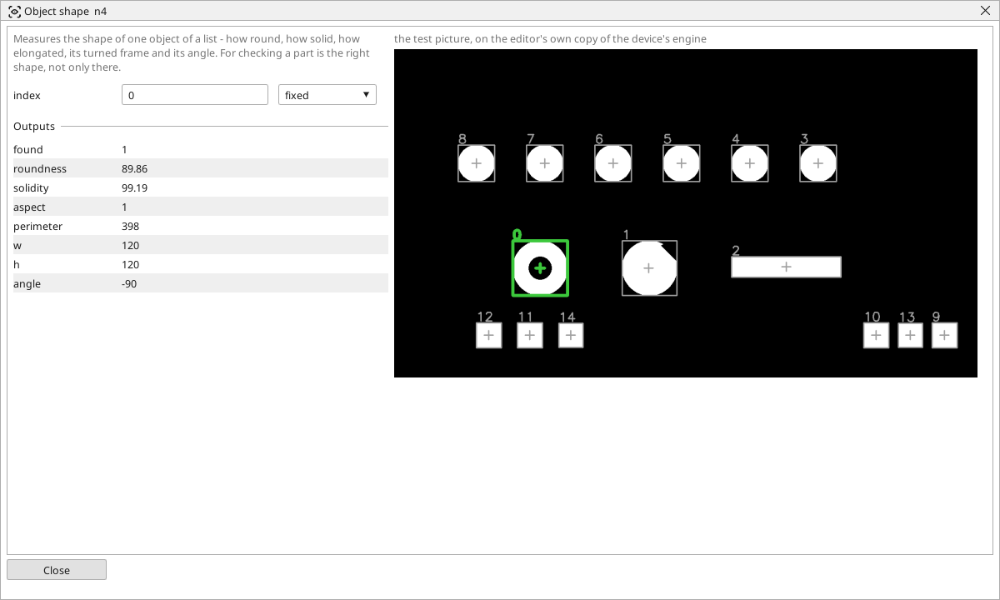

<!-- AUTOMATICALLY GENERATED from schema/visu-vision.yaml (tools/gen_vision.py) -->

# Object shape

**Finding objects** · in the trade: *shape descriptors (blob features)* · in a project file: `object_shape`

Measures the shape of one object of a list - how round, how solid, how elongated, its turned frame and its angle. For checking a part is the right shape, not only there.

{: .sb-center}

{: .sb-center}

## Where it runs

| Linux runtime, 64-bit | Linux runtime, 32-bit ARM | ESP32 boards | STM32 |
|:---:|:---:|:---:|:---:|
| yes | - | - | - |

**Needs:** a camera of the project (a USB camera or a stream address).

## Description

Measures the shape of one object of a list: how round it is (a disc 100, a line 0), how solid (a filled shape 100, a ring or a C less), how elongated (`aspect`, the long side of the turned frame over the short one), its perimeter, the sides of the turned frame and its angle. It is the block for "the part is the right shape, not only there": a bent pin has a different aspect, a chipped disc a lower roundness, a ring that should be a disc a lower solidity.

Feed the numbers into [In range](vision-in_range.md) for a yes/no, or into variables for a screen. `index` says which object of the list; *found* is off when the list is shorter.

## Typical uses

- a bent pin by its aspect
- a chipped disc by its roundness
- a ring that should be a disc by its solidity

## Inputs

| Input | Type | Meaning |
|:---|:---:|:---|
| `objects` | list of objects | the list the object is in |

## Outputs

| Output | Type | Meaning |
|:---|:---:|:---|
| `found` | yes/no | the list has an object at that index |
| `roundness` | number | 0..100 - how close to a disc |
| `solidity` | number | 0..100 - how filled the outline is |
| `aspect` | number | the turned frame's long side over its short side |
| `perimeter` | number | the length of the outline, in pixels |
| `w` | number | the turned frame's long side, in pixels |
| `h` | number | the turned frame's short side, in pixels |
| `angle` | number | the turned frame's angle, in degrees |

A number or a yes/no output goes into a variable of the PLC program (right-click the block on the Vision page, *Result ... into*); a text output into a STRING variable; a picture or a list of objects into the next block.

## Settings

| Setting | Range | Default | Unit | Meaning |
|:---|:---:|:---:|:---:|:---|
| `index` | 0 .. 999 | 0 |  | which object of the list |

Every number and yes/no setting can be read from a **variable** before each run instead of being fixed - pick it in the list beside the setting (the variable column of [the block's window](vision.md#the-blocks-window)). A text setting takes a STRING variable the same way.

---

Every block: [Vision blocks](vision-blocks.md) · how a program is drawn and what its window shows: [Vision](vision.md) · the cameras: [Cameras](cameras.md)
