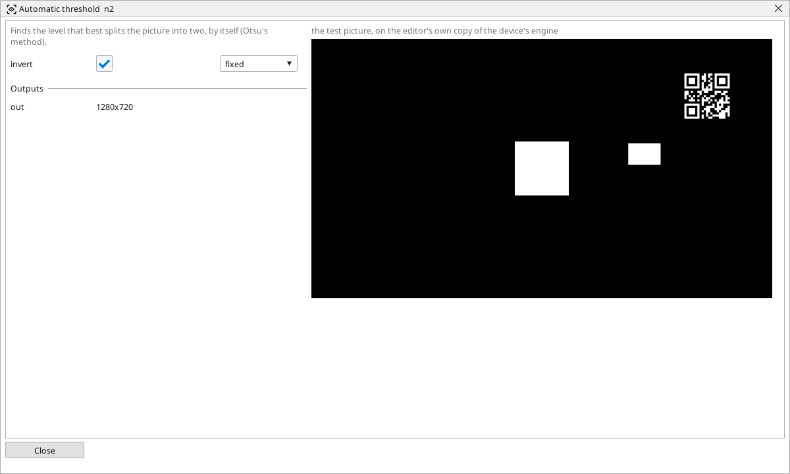

<!-- AUTOMATICALLY GENERATED from schema/visu-vision.yaml (tools/gen_vision.py) -->

# Automatic threshold

**Colour** · in the trade: *automatic binarisation (Otsu's method)* · in a project file: `otsu`

Finds the level that best splits the picture into two, by itself (Otsu's method).

{: .sb-center}

A threshold whose level is not typed but found on every picture: the block looks at how the brightness is spread and takes the level that best separates the picture into a dark and a bright group (Otsu's method). A part on its background comes out right under a stronger or a weaker lamp, where a fixed [Threshold](vision-threshold.md) would need a new level.

It wants a picture with two clear groups - a part and a background. A picture that is all background (no part) is still split into two somehow, so check *presence* another way before trusting its shapes. `invert` makes the dark group white.

## Typical uses

- a threshold that survives a changing lamp
- a part and a background of unknown shades

## Inputs

| Input | Type | Meaning |
|:---|:---:|:---|
| `src` | picture | a gray or colour picture |

## Outputs

| Output | Type | Meaning |
|:---|:---:|:---|
| `out` | picture | black and white, split at the level the block found |

A number or a yes/no output goes into a variable of the PLC program (right-click the block on the Vision page, *Result ... into*); a text output into a STRING variable; a picture or a list of objects into the next block.

## Settings

| Setting | Range | Default | Unit | Meaning |
|:---|:---:|:---:|:---:|:---|
| `invert` | yes / no | no |  | white where it is darker instead |

Every number and yes/no setting can be read from a **variable** before each run instead of being fixed - pick it in the list beside the setting (the variable column of [the block's window](vision.md#the-blocks-window)). A text setting takes a STRING variable the same way.

---

Every block: [Vision blocks](vision-blocks.md) · how a program is drawn and what its window shows: [Vision](vision.md) · the cameras: [Cameras](cameras.md)
