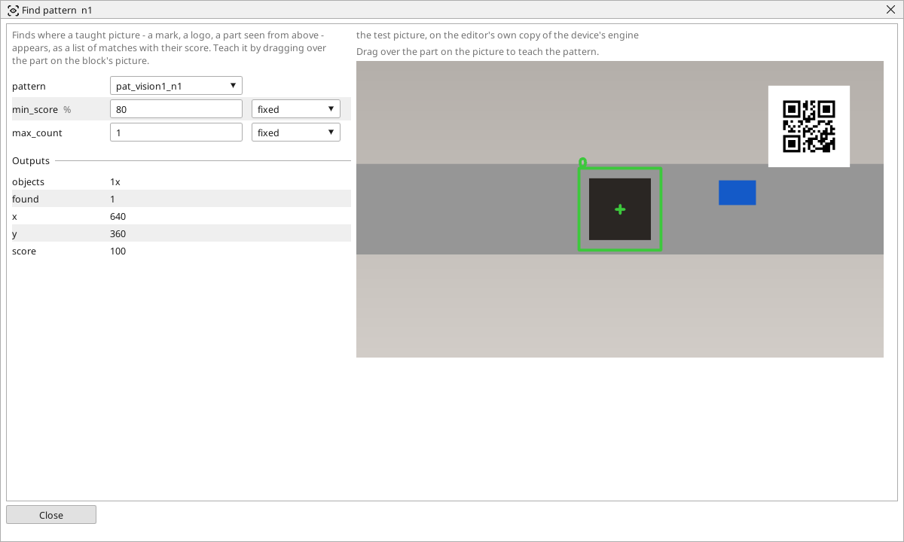

<!-- AUTOMATICALLY GENERATED from schema/visu-vision.yaml (tools/gen_vision.py) -->

# Find pattern

**Finding objects** · in the trade: *template matching (normalised cross-correlation)* · in a project file: `pattern`

Finds where a taught picture - a mark, a logo, a part seen from above - appears, as a list of matches with their score. Teach it by dragging over the part on the block's picture.

{: .sb-center}

Looks for a taught picture - a mark, a logo, the part seen from above - and says where it is. The block slides the taught picture over the whole picture and scores every place by how alike it is; the places scoring at least `min_score` are the matches, the best first, at most `max_count` of them. *found*, *x*, *y* and *score* describe the best one, *objects* carries them all.

Teach it by **dragging over the part on the block's picture**: the cut-out becomes a picture of the project (an asset) and the setting `pattern` names it. The part must look the same every time - the same size and the same way up; for a part that may be turned or nearer the camera use [Find by features](vision-features.md), and to put the whole picture right rather than only find the part use [Fixture](vision-fixture.md).

A score of 100 is a perfect match; 80 is a good threshold for a printed mark under steady light, 60 for a part whose surface varies. The window frames each match with its score.

## Typical uses

- a printed mark or a logo located
- a part seen from above found on the belt
- the presence of a feature that always looks the same

## Inputs

| Input | Type | Meaning |
|:---|:---:|:---|
| `src` | picture | the picture to search |

## Outputs

| Output | Type | Meaning |
|:---|:---:|:---|
| `objects` | list of objects | every match as an object, the best first |
| `found` | yes/no | at least one match reached min_score |
| `x` | number | the best match's centre, pixels from the left |
| `y` | number | the best match's centre, pixels from the top |
| `score` | number | how alike the best match is, in percent |

A number or a yes/no output goes into a variable of the PLC program (right-click the block on the Vision page, *Result ... into*); a text output into a STRING variable; a picture or a list of objects into the next block.

## Settings

| Setting | Range | Default | Unit | Meaning |
|:---|:---:|:---:|:---:|:---|
| `pattern` | text | (empty) |  | the taught picture (a picture asset of the project) |
| `min_score` | 1 .. 100 | 80 | % | how alike a place must be to count as a match |
| `max_count` | 1 .. 50 | 1 |  | at most this many matches |

Every number and yes/no setting can be read from a **variable** before each run instead of being fixed - pick it in the list beside the setting (the variable column of [the block's window](vision.md#the-blocks-window)). A text setting takes a STRING variable the same way.

## On the block's window

- **Drag over the part** on the picture: the cut-out becomes a picture of the project (an asset) and the setting `pattern` names it. Drag at least 8 x 8 pixels; teach on the test picture, not online.

---

Every block: [Vision blocks](vision-blocks.md) · how a program is drawn and what its window shows: [Vision](vision.md) · the cameras: [Cameras](cameras.md)
