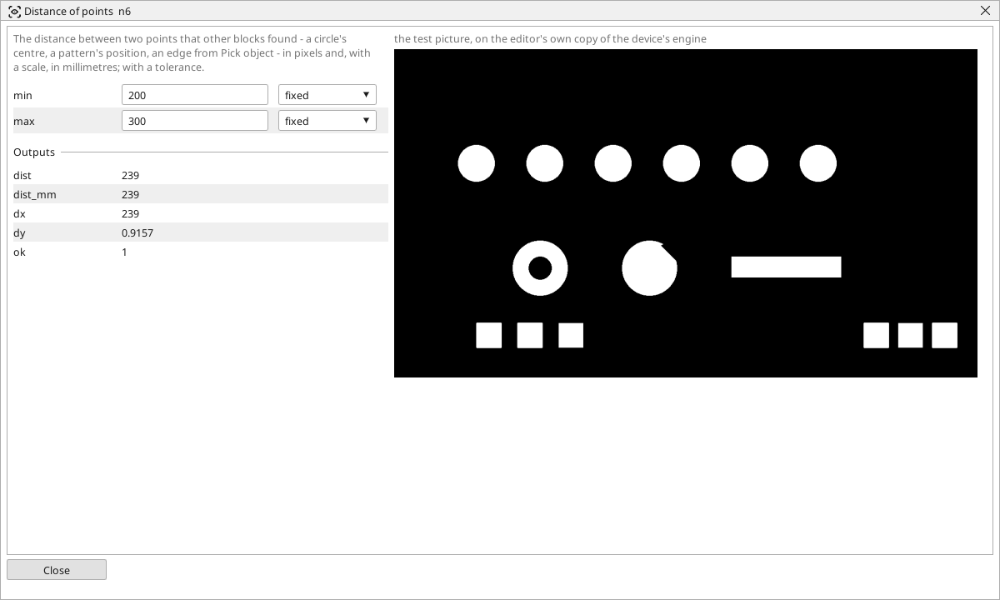

<!-- AUTOMATICALLY GENERATED from schema/visu-vision.yaml (tools/gen_vision.py) -->

# Distance of points

**Measurements** · in the trade: *distance gauge* · in a project file: `points_dist`

The distance between two points that other blocks found - a circle's centre, a pattern's position, an edge from Pick object - in pixels and, with a scale, in millimetres; with a tolerance.

{: .sb-center}

The distance between two points other blocks found - a circle's centre and a corner, a pattern's position and a marker, two edges from a [Caliper](vision-caliper.md) through [Pick object](vision-pick.md) - in pixels and, with a scale wired in, in millimetres, with `min`/`max` making *ok* a tolerance check. It is the general gauge: wire any two x/y pairs into it and the distance between them is a measurement with a tolerance.

*dx* and *dy* are the components, for a correction that moves an axis.

## Typical uses

- the length of a part between two found edges
- the distance of a hole from a corner
- the offset of a part from its nominal place

## Inputs

| Input | Type | Meaning |
|:---|:---:|:---|
| `x1` | number | the first point's x |
| `y1` | number | the first point's y |
| `x2` | number | the second point's x |
| `y2` | number | the second point's y |
| `scale` | number (optional) | millimetres per pixel from a Ruler or a Plane block (optional) |

## Outputs

| Output | Type | Meaning |
|:---|:---:|:---|
| `dist` | number | the distance, in pixels |
| `dist_mm` | number | the distance through the scale (px when none) |
| `dx` | number | x2 - x1 |
| `dy` | number | y2 - y1 |
| `ok` | yes/no | the distance lies between min and max |

A number or a yes/no output goes into a variable of the PLC program (right-click the block on the Vision page, *Result ... into*); a text output into a STRING variable; a picture or a list of objects into the next block.

## Settings

| Setting | Range | Default | Unit | Meaning |
|:---|:---:|:---:|:---:|:---|
| `min` | 0 .. 100000 | 0 |  | the distance must be at least this (0 = no limit) - mm with a scale |
| `max` | 0 .. 100000 | 0 |  | the distance must be at most this (0 = no limit) |

Every number and yes/no setting can be read from a **variable** before each run instead of being fixed - pick it in the list beside the setting (the variable column of [the block's window](vision.md#the-blocks-window)). A text setting takes a STRING variable the same way.

---

Every block: [Vision blocks](vision-blocks.md) · how a program is drawn and what its window shows: [Vision](vision.md) · the cameras: [Cameras](cameras.md)
