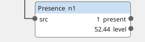
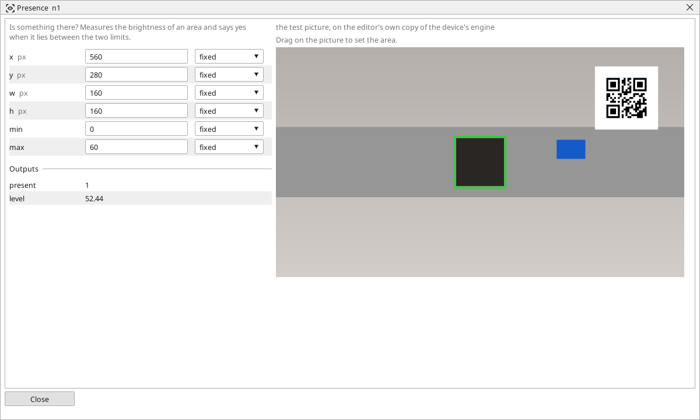

<!-- AUTOMATICALLY GENERATED from schema/visu-vision.yaml (tools/gen_vision.py) -->

# Presence

**Ready tools** · in the trade: *presence/absence check* · in a project file: `presence`

Is something there? Measures the brightness of an area and says yes when it lies between the two limits.

{: .sb-center}

{: .sb-center}

## Where it runs

| Linux runtime, 64-bit | Linux runtime, 32-bit ARM | ESP32 boards | STM32 |
|:---:|:---:|:---:|:---:|
| yes | - | - | - |

**Needs:** a camera of the project (a USB camera or a stream address).

## Description

Is something there? The block measures the mean brightness of an area and says *present* when it lies between `min` and `max` - a dark part on a light belt, a light part on a dark table, a hand over the lens. It is the first check every line needs and the one most often enough: no threshold, no objects, one area and two limits.

Drag the area on the block's picture over the place the part belongs, read *level* with the part there and without, and set the limits between the two. The window frames the area green when the answer is yes and red when it is no. A part whose brightness is close to the background's wants [Colour check](vision-colour.md) (by hue) or [Part in place](vision-part_ok.md) (by shape).

## Typical uses

- is the part in position before the next step
- is the bin, the slot, the nest empty
- is the lens covered or the lamp off

## Inputs

| Input | Type | Meaning |
|:---|:---:|:---|
| `src` | picture | the picture (a colour one is taken by its brightness) |

## Outputs

| Output | Type | Meaning |
|:---|:---:|:---|
| `present` | yes/no | the area's mean brightness lies between min and max |
| `level` | number | the area's mean brightness, 0..255 |

A number or a yes/no output goes into a variable of the PLC program (right-click the block on the Vision page, *Result ... into*); a text output into a STRING variable; a picture or a list of objects into the next block.

## Settings

| Setting | Range | Default | Unit | Meaning |
|:---|:---:|:---:|:---:|:---|
| `x` | 0 .. 8192 | 0 | px | left edge of the area |
| `y` | 0 .. 8192 | 0 | px | top edge of the area |
| `w` | 1 .. 8192 | 100 | px | width of the area |
| `h` | 1 .. 8192 | 100 | px | height of the area |
| `min` | 0 .. 255 | 0 |  | darkest brightness that means "present" |
| `max` | 0 .. 255 | 100 |  | brightest brightness that means "present" |

Every number and yes/no setting can be read from a **variable** before each run instead of being fixed - pick it in the list beside the setting (the variable column of [the block's window](vision.md#the-blocks-window)). A text setting takes a STRING variable the same way.

## On the block's window

- **Drag on the picture** to set the area (`x`, `y`, `w`, `h`). The numbers follow and can still be typed.

---

Every block: [Vision blocks](vision-blocks.md) · how a program is drawn and what its window shows: [Vision](vision.md) · the cameras: [Cameras](cameras.md)
