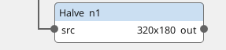
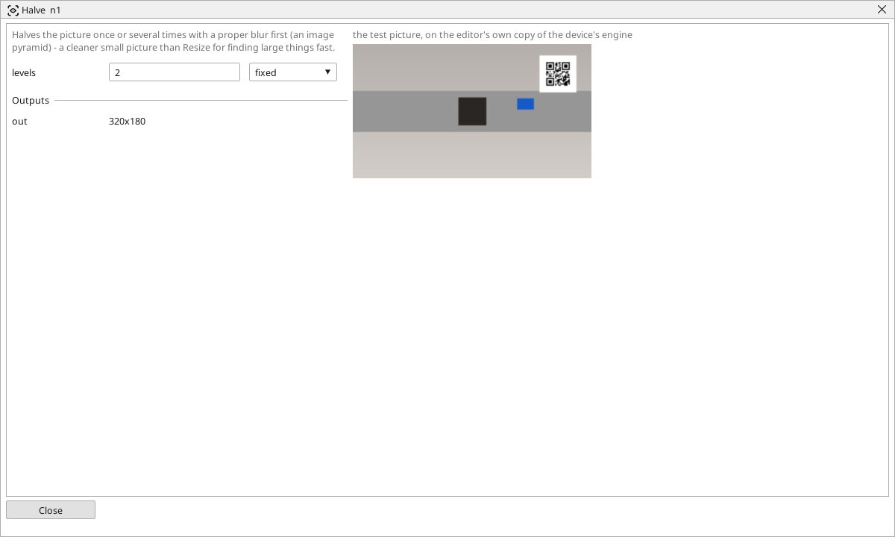

<!-- AUTOMATICALLY GENERATED from schema/visu-vision.yaml (tools/gen_vision.py) -->

# Halve

**Geometry** · in the trade: *image pyramid (pyrDown)* · in a project file: `pyramid`

Halves the picture once or several times with a proper blur first (an image pyramid) - a cleaner small picture than Resize for finding large things fast.

{: .sb-center}

{: .sb-center}

## Where it runs

| Linux runtime, 64-bit | Linux runtime, 32-bit ARM | ESP32 boards | STM32 |
|:---:|:---:|:---:|:---:|
| yes | - | - | - |

**Needs:** a camera of the project (a USB camera or a stream address).

## Description

Halves the picture once or several times, with the proper blur before each halving that keeps the small picture clean (an image pyramid). Two levels turn 1280 x 720 into 320 x 180 - a sixteenth of the pixels, and a Find pattern or a Find objects on it runs that much faster.

Prefer it to [Resize](vision-resize.md) when the picture is halved: Resize at 50 % simply drops every other pixel and thin lines flicker from picture to picture; Halve averages them away. The areas of the blocks after it are in pixels of the small picture.

## Typical uses

- a fast Find pattern on a small picture
- a clean quarter-size picture for presence checks

## Inputs

| Input | Type | Meaning |
|:---|:---:|:---|
| `src` | picture | the picture to halve |

## Outputs

| Output | Type | Meaning |
|:---|:---:|:---|
| `out` | picture | the picture halved `levels` times |

A number or a yes/no output goes into a variable of the PLC program (right-click the block on the Vision page, *Result ... into*); a text output into a STRING variable; a picture or a list of objects into the next block.

## Settings

| Setting | Range | Default | Unit | Meaning |
|:---|:---:|:---:|:---:|:---|
| `levels` | 1 .. 4 | 1 |  | how many times it is halved |

Every number and yes/no setting can be read from a **variable** before each run instead of being fixed - pick it in the list beside the setting (the variable column of [the block's window](vision.md#the-blocks-window)). A text setting takes a STRING variable the same way.

---

Every block: [Vision blocks](vision-blocks.md) · how a program is drawn and what its window shows: [Vision](vision.md) · the cameras: [Cameras](cameras.md)
