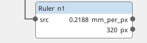
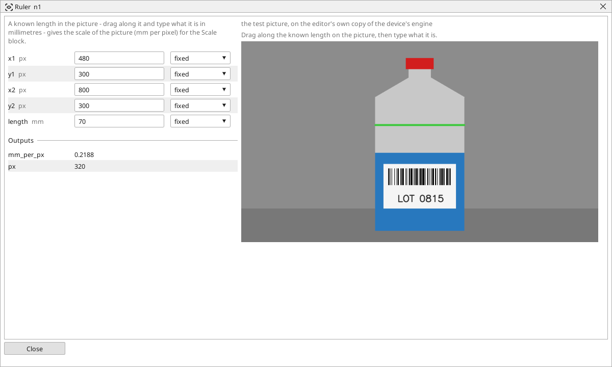

<!-- AUTOMATICALLY GENERATED from schema/visu-vision.yaml (tools/gen_vision.py) -->

# Ruler

**Measurements** · in the trade: *scale calibration, pixel size* · in a project file: `ruler`

A known length in the picture - drag along it and type what it is in millimetres - gives the scale of the picture (mm per pixel) for the Scale block.

{: .sb-center}

{: .sb-center}

## Where it runs

| Linux runtime, 64-bit | Linux runtime, 32-bit ARM | ESP32 boards | STM32 |
|:---:|:---:|:---:|:---:|
| yes | - | - | - |

**Needs:** a camera of the project (a USB camera or a stream address).

## Description

Calibrates the picture: a known length - the part's width, a printed mark, a rule laid on the belt - is dragged on the block's picture and its real length typed, and the block answers how many millimetres one pixel is. Its *mm_per_px* feeds the **scale** input of the measuring blocks and the [Scale](vision-scale.md) block's `factor_in`; from then on they answer in millimetres.

The scale holds where the camera's distance and angle hold: across a flat plane the camera faces squarely. A camera at an angle, or a wide lens, gives a different scale in different parts of the picture - [Plane from a board](vision-world.md) handles that case with one chessboard, and [Lens correction](vision-undistort.md) takes the lens out of it. Measure the known length in the middle of where the parts will be, and take it as long as the picture allows: a 10 px error on a 100 px length is 10 %, on a 1000 px length 1 %.

## Typical uses

- one calibration per camera, feeding every measuring block
- a quick check that the camera has not moved (the pixel length of a fixed mark changes)

## Inputs

| Input | Type | Meaning |
|:---|:---:|:---|
| `src` | picture | the picture the length is dragged on (the block only measures it) |

## Outputs

| Output | Type | Meaning |
|:---|:---:|:---|
| `mm_per_px` | number | millimetres per pixel: the typed length over the dragged length |
| `px` | number | the dragged length, in pixels |

A number or a yes/no output goes into a variable of the PLC program (right-click the block on the Vision page, *Result ... into*); a text output into a STRING variable; a picture or a list of objects into the next block.

## Settings

| Setting | Range | Default | Unit | Meaning |
|:---|:---:|:---:|:---:|:---|
| `x1` | 0 .. 8192 | 100 | px | one end of the known length |
| `y1` | 0 .. 8192 | 100 | px | one end of the known length |
| `x2` | 0 .. 8192 | 300 | px | the other end |
| `y2` | 0 .. 8192 | 100 | px | the other end |
| `length` | 0.001 .. 100000 | 100 | mm | what the length really is |

Every number and yes/no setting can be read from a **variable** before each run instead of being fixed - pick it in the list beside the setting (the variable column of [the block's window](vision.md#the-blocks-window)). A text setting takes a STRING variable the same way.

## On the block's window

- **Drag along the line** on the picture: `x1`, `y1`, `x2`, `y2` take its ends.

## Used in

- Bottle check - a shipped example project

---

Every block: [Vision blocks](vision-blocks.md) · how a program is drawn and what its window shows: [Vision](vision.md) · the cameras: [Cameras](cameras.md)
