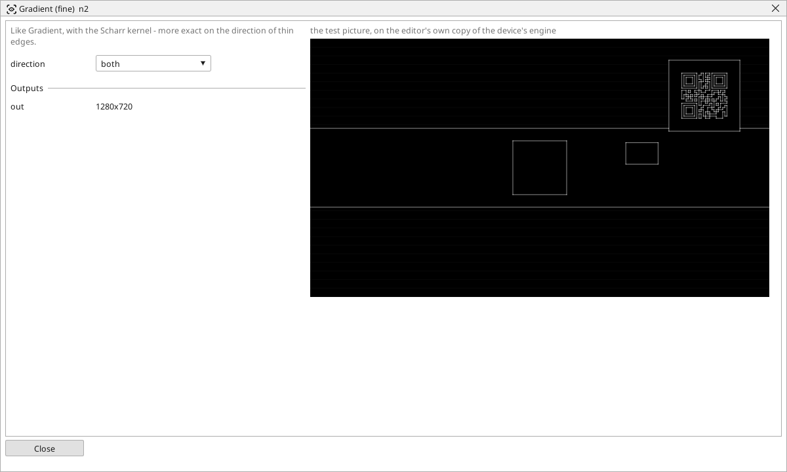

<!-- AUTOMATICALLY GENERATED from schema/visu-vision.yaml (tools/gen_vision.py) -->

# Gradient (fine)

**Edges** · in the trade: *gradient (Scharr operator)* · in a project file: `scharr`

Like Gradient, with the Scharr kernel - more exact on the direction of thin edges.

{: .sb-center}

The same as [Gradient](vision-sobel.md) with the Scharr kernel, which is more exact about the direction of thin edges and responds the same to an edge whatever its angle. Prefer it when the angle of an edge matters - before a [Line (fit)](vision-line_fit.md) on a thin line - and the plain Gradient when it does not.

## Typical uses

- thin edges whose angle matters
- a cleaner edge picture before a Line (fit)

## Inputs

| Input | Type | Meaning |
|:---|:---:|:---|
| `src` | picture | a gray or colour picture |

## Outputs

| Output | Type | Meaning |
|:---|:---:|:---|
| `out` | picture | the edge strength at every point, as a gray picture |

A number or a yes/no output goes into a variable of the PLC program (right-click the block on the Vision page, *Result ... into*); a text output into a STRING variable; a picture or a list of objects into the next block.

## Settings

| Setting | Range | Default | Unit | Meaning |
|:---|:---:|:---:|:---:|:---|
| `direction` | both / x / y | both |  | edges across (x) |

Every number and yes/no setting can be read from a **variable** before each run instead of being fixed - pick it in the list beside the setting (the variable column of [the block's window](vision.md#the-blocks-window)). A text setting takes a STRING variable the same way.

---

Every block: [Vision blocks](vision-blocks.md) · how a program is drawn and what its window shows: [Vision](vision.md) · the cameras: [Cameras](cameras.md)
