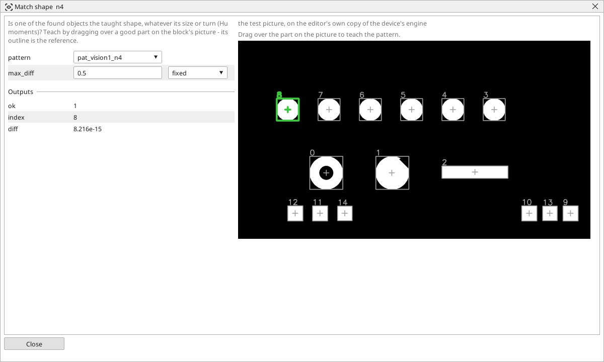

<!-- AUTOMATICALLY GENERATED from schema/visu-vision.yaml (tools/gen_vision.py) -->

# Match shape

**Ready tools** · in the trade: *shape matching, Hu moment invariants* · in a project file: `shape`

Is one of the found objects the taught shape, whatever its size or turn (Hu moments)? Teach by dragging over a good part on the block's picture - its outline is the reference.

{: .sb-center}

Is one of the found objects the taught shape, whatever its size or how it is turned? The block compares the outline of every object of a list with the outline taught on a good part (Hu moments, which do not change with scale or rotation) and reports the closest one: *index* says which, *diff* how different, *ok* whether the difference stays under `max_diff`. The right part among several on a tray, a part that is complete (a broken corner changes the outline), the right orientation of a part that is not symmetric.

Teach by dragging over a good part on the block's picture: its outline becomes the reference. Feed the list from [Find objects](vision-contours.md) after a clean threshold - the outline is only as good as the threshold. `max_diff` of 0.5 is a good start; read *diff* on good and on wrong parts and set it between.

## Typical uses

- the right part among several on a tray
- a part that is complete, not chipped or broken
- the orientation of a part that is not symmetric

## Inputs

| Input | Type | Meaning |
|:---|:---:|:---|
| `objects` | list of objects | the list of objects to compare |

## Outputs

| Output | Type | Meaning |
|:---|:---:|:---|
| `ok` | yes/no | the closest object differs by at most max_diff |
| `index` | number | which object of the list is the closest |
| `diff` | number | how different its outline is from the taught one (0 = the same shape) |

A number or a yes/no output goes into a variable of the PLC program (right-click the block on the Vision page, *Result ... into*); a text output into a STRING variable; a picture or a list of objects into the next block.

## Settings

| Setting | Range | Default | Unit | Meaning |
|:---|:---:|:---:|:---:|:---|
| `pattern` | text | (empty) |  | the taught picture the outline is taken from (one of the project's pictures) |
| `max_diff` | 0 .. 10 | 0.5 |  | how different the closest object's outline may be (0 = the same shape) |

Every number and yes/no setting can be read from a **variable** before each run instead of being fixed - pick it in the list beside the setting (the variable column of [the block's window](vision.md#the-blocks-window)). A text setting takes a STRING variable the same way.

## On the block's window

- **Drag over a good part** on the picture: its outline becomes the reference the setting `pattern` names.

---

Every block: [Vision blocks](vision-blocks.md) · how a program is drawn and what its window shows: [Vision](vision.md) · the cameras: [Cameras](cameras.md)
