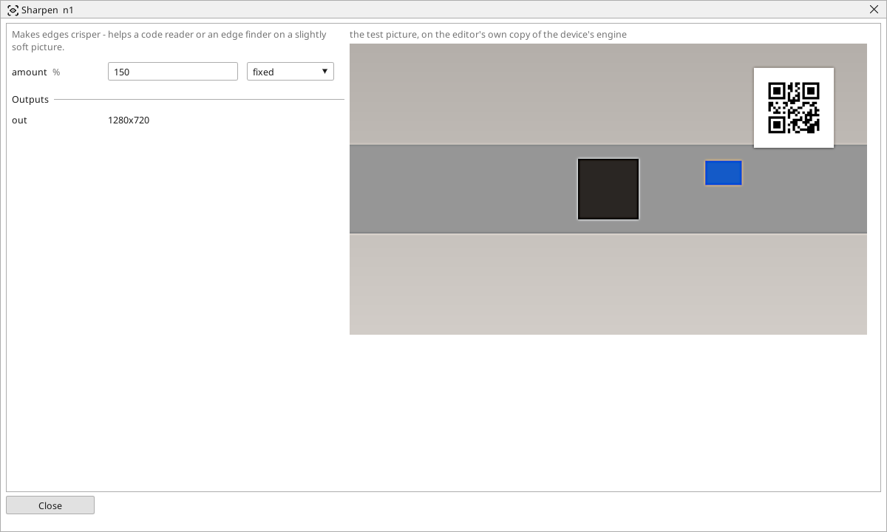

<!-- AUTOMATICALLY GENERATED from schema/visu-vision.yaml (tools/gen_vision.py) -->

# Sharpen

**Filters** · in the trade: *unsharp masking* · in a project file: `sharpen`

Makes edges crisper - helps a code reader or an edge finder on a slightly soft picture.

{: .sb-center}

Makes edges crisper by adding the picture's own detail back to it (an unsharp mask). A slightly soft picture - a camera a little out of focus, a cheap lens, a code at the limit of the camera's resolution - reads better after it. `amount` is the strength in percent: 100 is a moderate sharpening, 200 and above makes a noisy picture noisier too.

It cannot create detail the camera did not deliver: a code whose bars are blurred into each other stays unreadable. In the shipped code-reading example the amount is a variable the operator turns on the screen while watching the preview.

## Typical uses

- a code at the limit of the camera's sharpness
- an edge finder on a slightly soft picture

## Inputs

| Input | Type | Meaning |
|:---|:---:|:---|
| `src` | picture | a soft picture |

## Outputs

| Output | Type | Meaning |
|:---|:---:|:---|
| `out` | picture | the sharpened picture |

A number or a yes/no output goes into a variable of the PLC program (right-click the block on the Vision page, *Result ... into*); a text output into a STRING variable; a picture or a list of objects into the next block.

## Settings

| Setting | Range | Default | Unit | Meaning |
|:---|:---:|:---:|:---:|:---|
| `amount` | 1 .. 300 | 100 | % | how much |

Every number and yes/no setting can be read from a **variable** before each run instead of being fixed - pick it in the list beside the setting (the variable column of [the block's window](vision.md#the-blocks-window)). A text setting takes a STRING variable the same way.

## Used in

- The reTerminal with EtherCAT (the code reader) - a shipped example project

---

Every block: [Vision blocks](vision-blocks.md) · how a program is drawn and what its window shows: [Vision](vision.md) · the cameras: [Cameras](cameras.md)
