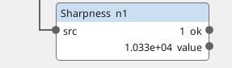
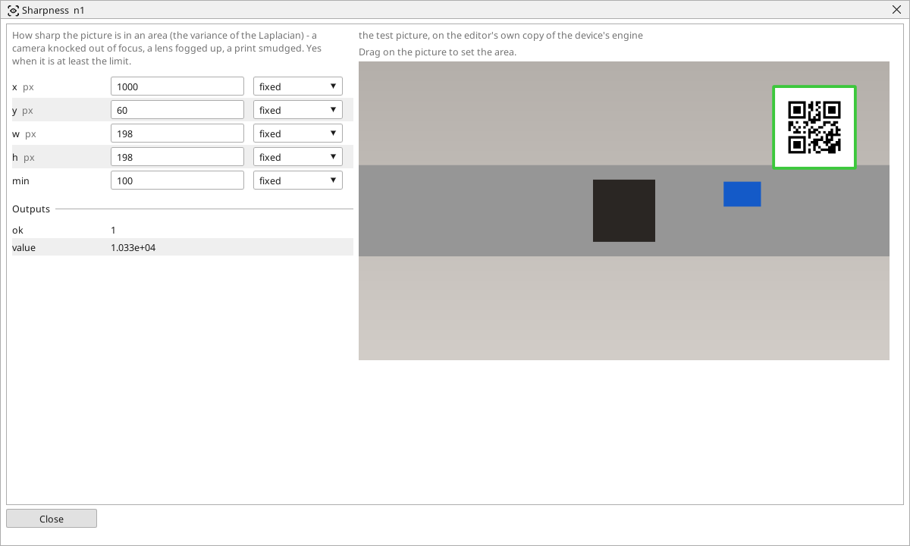

<!-- AUTOMATICALLY GENERATED from schema/visu-vision.yaml (tools/gen_vision.py) -->

# Sharpness

**Measurements** · in the trade: *focus measure, variance of the Laplacian* · in a project file: `sharpness`

How sharp the picture is in an area (the variance of the Laplacian) - a camera knocked out of focus, a lens fogged up, a print smudged. Yes when it is at least the limit.

{: .sb-center}

{: .sb-center}

## Where it runs

| Linux runtime, 64-bit | Linux runtime, 32-bit ARM | ESP32 boards | STM32 |
|:---:|:---:|:---:|:---:|
| yes | - | - | - |

**Needs:** a camera of the project (a USB camera or a stream address).

## Description

How sharp the picture is in an area - the variance of the Laplacian, the focus measure that autofocus algorithms use. A camera knocked out of focus, a lens fogged or dirty, a window smeared, a print that smudged - all of them lower it, and a check that silently reads a blurred picture is the check that passes bad parts. *ok* is on while the value stays at least `min`.

Read the value on a good, sharp picture of the real part and set `min` at about half of it; the value depends on the content of the area (a plain surface scores low however sharp), so the area should hold edges or print. One Sharpness block on the picture is a cheap guard for every other check in the program - wire its *ok* into the PLC program's "camera fine" condition.

## Typical uses

- a guard that the camera is in focus and the lens clean
- finding the best focus when setting the camera up
- a smudged or faded print

## Inputs

| Input | Type | Meaning |
|:---|:---:|:---|
| `src` | picture | the picture (a colour one is taken by its brightness) |

## Outputs

| Output | Type | Meaning |
|:---|:---:|:---|
| `ok` | yes/no | the sharpness is at least min |
| `value` | number | the sharpness (the variance of the Laplacian in the area) |

A number or a yes/no output goes into a variable of the PLC program (right-click the block on the Vision page, *Result ... into*); a text output into a STRING variable; a picture or a list of objects into the next block.

## Settings

| Setting | Range | Default | Unit | Meaning |
|:---|:---:|:---:|:---:|:---|
| `x` | 0 .. 8192 | 0 | px | left edge of the area |
| `y` | 0 .. 8192 | 0 | px | top edge of the area |
| `w` | 1 .. 8192 | 200 | px | width of the area |
| `h` | 1 .. 8192 | 200 | px | height of the area |
| `min` | 0 .. 1000000 | 100 |  | the sharpness that is still fine (read the value on a good picture |

Every number and yes/no setting can be read from a **variable** before each run instead of being fixed - pick it in the list beside the setting (the variable column of [the block's window](vision.md#the-blocks-window)). A text setting takes a STRING variable the same way.

## On the block's window

- **Drag on the picture** to set the area (`x`, `y`, `w`, `h`). The numbers follow and can still be typed.

---

Every block: [Vision blocks](vision-blocks.md) · how a program is drawn and what its window shows: [Vision](vision.md) · the cameras: [Cameras](cameras.md)
