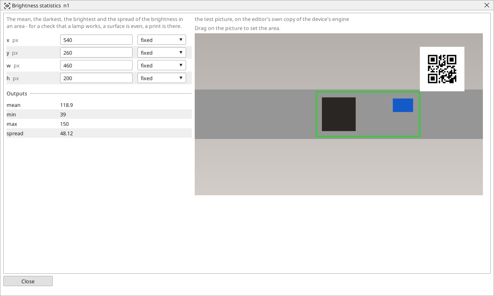

<!-- AUTOMATICALLY GENERATED from schema/visu-vision.yaml (tools/gen_vision.py) -->

# Brightness statistics

**Measurements** · in the trade: *intensity statistics* · in a project file: `stats`

The mean, the darkest, the brightest and the spread of the brightness in an area - for a check that a lamp works, a surface is even, a print is there.

{: .sb-center}

The mean, the darkest point, the brightest point and the spread (standard deviation) of the brightness in an area. Four numbers that say more than one: a lamp that works gives the expected mean, an even surface a small spread, a print in the area a large one, a glint a high maximum. The area is dragged on the block's picture.

Send the four into variables for a screen or a trend, or follow one with [In range](vision-in_range.md). [Histogram](vision-histogram.md) answers the related question "how are the shades distributed".

## Typical uses

- is the surface even (a small spread)
- is there print or a mark in the area (a large spread)
- a lighting trend on a screen

## Inputs

| Input | Type | Meaning |
|:---|:---:|:---|
| `src` | picture | the picture (a colour one is taken by its brightness) |

## Outputs

| Output | Type | Meaning |
|:---|:---:|:---|
| `mean` | number | the mean brightness of the area, 0..255 |
| `min` | number | the darkest point |
| `max` | number | the brightest point |
| `spread` | number | the standard deviation of the brightness |

A number or a yes/no output goes into a variable of the PLC program (right-click the block on the Vision page, *Result ... into*); a text output into a STRING variable; a picture or a list of objects into the next block.

## Settings

| Setting | Range | Default | Unit | Meaning |
|:---|:---:|:---:|:---:|:---|
| `x` | 0 .. 8192 | 0 | px | left edge of the area |
| `y` | 0 .. 8192 | 0 | px | top edge of the area |
| `w` | 1 .. 8192 | 200 | px | width of the area |
| `h` | 1 .. 8192 | 200 | px | height of the area |

Every number and yes/no setting can be read from a **variable** before each run instead of being fixed - pick it in the list beside the setting (the variable column of [the block's window](vision.md#the-blocks-window)). A text setting takes a STRING variable the same way.

## On the block's window

- **Drag on the picture** to set the area (`x`, `y`, `w`, `h`). The numbers follow and can still be typed.

---

Every block: [Vision blocks](vision-blocks.md) · how a program is drawn and what its window shows: [Vision](vision.md) · the cameras: [Cameras](cameras.md)
