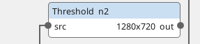
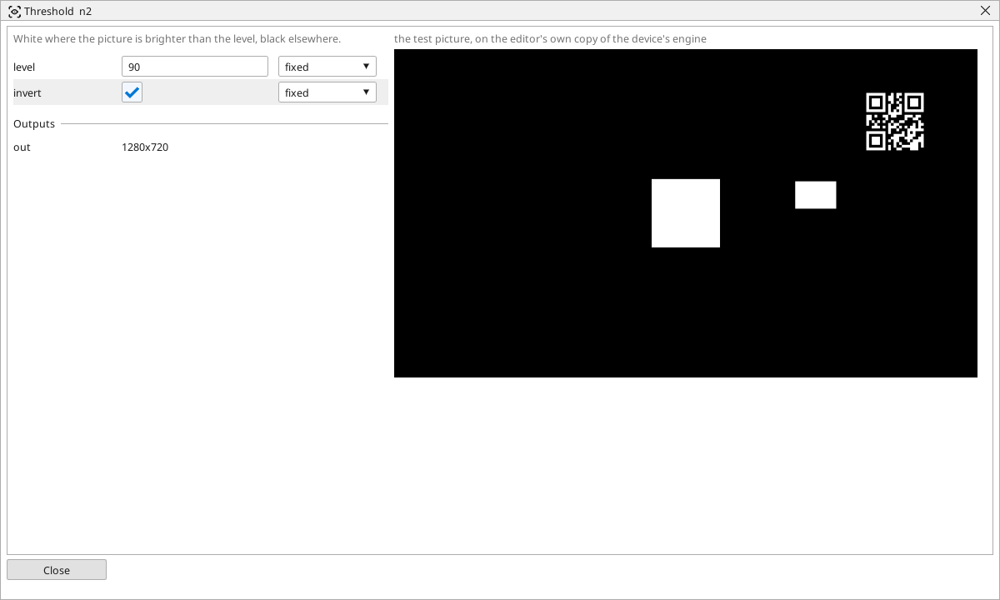

<!-- AUTOMATICALLY GENERATED from schema/visu-vision.yaml (tools/gen_vision.py) -->

# Threshold

**Colour** · in the trade: *binarisation, fixed threshold* · in a project file: `threshold`

White where the picture is brighter than the level, black elsewhere.

{: .sb-center}

{: .sb-center}

## Where it runs

| Linux runtime, 64-bit | Linux runtime, 32-bit ARM | ESP32 boards | STM32 |
|:---:|:---:|:---:|:---:|
| yes | - | - | - |

**Needs:** a camera of the project (a USB camera or a stream address).

## Description

Splits a picture into black and white at one level of brightness: a point brighter than `level` is white, a darker one black (or the other way round with `invert`). It is the step from a gray picture to shapes - everything that finds objects, counts them or measures white wants a black-and-white picture, and this is the simplest way to make one.

Read the level off the block's picture: move it until the part is white and the background black with no specks between. A level that works in the morning and fails in the evening is a sign that the light changes - use [Automatic threshold](vision-otsu.md), [Adaptive threshold](vision-adaptive.md) or [Stretch contrast](vision-normalize.md) before it.

## Typical uses

- a dark part on a light belt as a white shape
- the step before Find objects and Count objects
- a print as shapes to count

## Inputs

| Input | Type | Meaning |
|:---|:---:|:---|
| `src` | picture | a gray or colour picture (a colour one is taken by its brightness) |

## Outputs

| Output | Type | Meaning |
|:---|:---:|:---|
| `out` | picture | black and white: white above the level (below it with invert) |

A number or a yes/no output goes into a variable of the PLC program (right-click the block on the Vision page, *Result ... into*); a text output into a STRING variable; a picture or a list of objects into the next block.

## Settings

| Setting | Range | Default | Unit | Meaning |
|:---|:---:|:---:|:---:|:---|
| `level` | 0 .. 255 | 128 |  | brightness that splits black from white |
| `invert` | yes / no | no |  | white where it is darker instead |

Every number and yes/no setting can be read from a **variable** before each run instead of being fixed - pick it in the list beside the setting (the variable column of [the block's window](vision.md#the-blocks-window)). A text setting takes a STRING variable the same way.

---

Every block: [Vision blocks](vision-blocks.md) · how a program is drawn and what its window shows: [Vision](vision.md) · the cameras: [Cameras](cameras.md)
