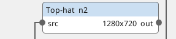
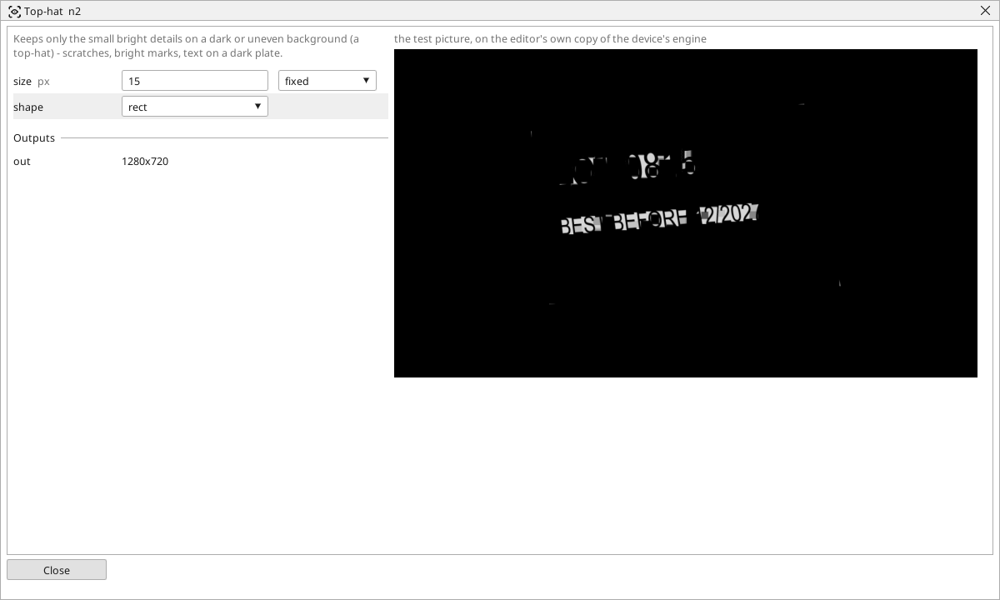

<!-- AUTOMATICALLY GENERATED from schema/visu-vision.yaml (tools/gen_vision.py) -->

# Top-hat

**Shapes** · in the trade: *top-hat transform (white top-hat)* · in a project file: `tophat`

Keeps only the small bright details on a dark or uneven background (a top-hat) - scratches, bright marks, text on a dark plate.

{: .sb-center}

{: .sb-center}

## Where it runs

| Linux runtime, 64-bit | Linux runtime, 32-bit ARM | ESP32 boards | STM32 |
|:---:|:---:|:---:|:---:|
| yes | - | - | - |

**Needs:** a camera of the project (a USB camera or a stream address).

## Description

Keeps only the small bright details and removes everything larger - the background, the part's broad surfaces, a slow change of brightness across the picture. The picture minus its own Open with a brush of `size` pixels is what remains: scratches, bright marks, the print on a dark plate, a reflection, anything bright and smaller than the brush.

Set `size` a little larger than the detail to keep; a threshold after it turns the detail into shapes. The brush is a rectangle, an ellipse or a cross - the ellipse treats every direction alike. [Black-hat](vision-blackhat.md) is the same for small DARK details.

## Typical uses

- scratches and bright marks on a dark surface
- print on a dark plate
- a reflection found and masked out

## Inputs

| Input | Type | Meaning |
|:---|:---:|:---|
| `src` | picture | a gray picture |

## Outputs

| Output | Type | Meaning |
|:---|:---:|:---|
| `out` | picture | the small bright details on a black background |

A number or a yes/no output goes into a variable of the PLC program (right-click the block on the Vision page, *Result ... into*); a text output into a STRING variable; a picture or a list of objects into the next block.

## Settings

| Setting | Range | Default | Unit | Meaning |
|:---|:---:|:---:|:---:|:---|
| `size` | 1 .. 99 | 9 | px | a detail larger than this is background |
| `shape` | rect / ellipse / cross | rect |  | the shape of the structuring element |

Every number and yes/no setting can be read from a **variable** before each run instead of being fixed - pick it in the list beside the setting (the variable column of [the block's window](vision.md#the-blocks-window)). A text setting takes a STRING variable the same way.

---

Every block: [Vision blocks](vision-blocks.md) · how a program is drawn and what its window shows: [Vision](vision.md) · the cameras: [Cameras](cameras.md)
