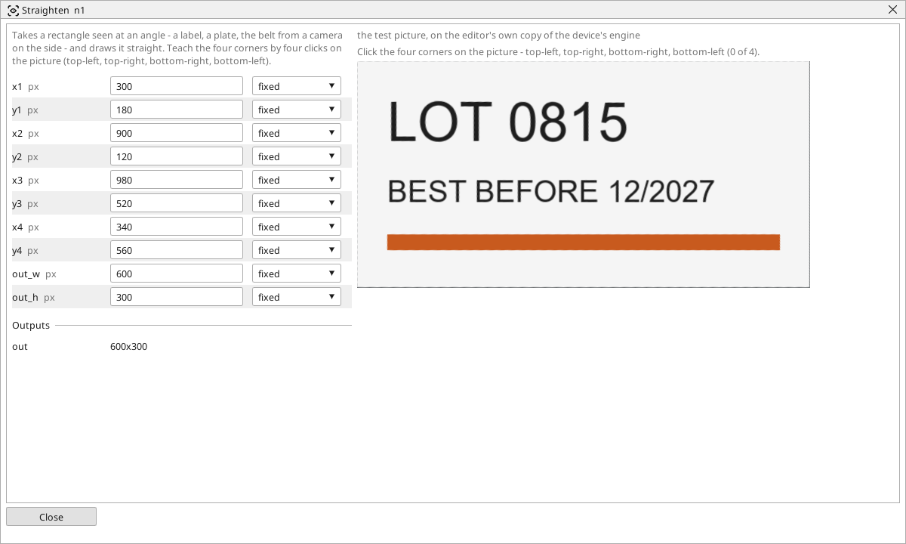

<!-- AUTOMATICALLY GENERATED from schema/visu-vision.yaml (tools/gen_vision.py) -->

# Straighten

**Geometry** · in the trade: *perspective correction (homography)* · in a project file: `warp`

Takes a rectangle seen at an angle - a label, a plate, the belt from a camera on the side - and draws it straight. Teach the four corners by four clicks on the picture (top-left, top-right, bottom-right, bottom-left).

{: .sb-center}

Takes a rectangle that the camera sees at an angle - a label on a bottle's shoulder, a plate on the side of a crate, the belt seen from a camera mounted beside it - and draws it as if the camera looked at it straight on. The four corners of the rectangle in the picture are taught by four clicks (top-left, top-right, bottom-right, bottom-left); `out_w` and `out_h` say how large the straightened picture is.

Use it before a Read code or a Find pattern that fails because the code is foreshortened, and before any measurement across a surface the camera does not face: on the straightened picture one millimetre is the same number of pixels everywhere, which it is not in the original.

[Plane from a board](vision-world.md) does the same for a whole working plane from a chessboard, with the scale in millimetres known; Straighten is the quick way when the four corners are easy to click.

## Typical uses

- a label on a bottle's shoulder read straight on
- a plate on the side of a crate
- the belt seen from a camera beside it

## Inputs

| Input | Type | Meaning |
|:---|:---:|:---|
| `src` | picture | the picture seen at an angle |

## Outputs

| Output | Type | Meaning |
|:---|:---:|:---|
| `out` | picture | the rectangle drawn straight, out_w x out_h pixels |

A number or a yes/no output goes into a variable of the PLC program (right-click the block on the Vision page, *Result ... into*); a text output into a STRING variable; a picture or a list of objects into the next block.

## Settings

| Setting | Range | Default | Unit | Meaning |
|:---|:---:|:---:|:---:|:---|
| `x1` | 0 .. 8192 | 100 | px | top-left corner |
| `y1` | 0 .. 8192 | 100 | px | top-left corner |
| `x2` | 0 .. 8192 | 500 | px | top-right corner |
| `y2` | 0 .. 8192 | 100 | px | top-right corner |
| `x3` | 0 .. 8192 | 500 | px | bottom-right corner |
| `y3` | 0 .. 8192 | 400 | px | bottom-right corner |
| `x4` | 0 .. 8192 | 100 | px | bottom-left corner |
| `y4` | 0 .. 8192 | 400 | px | bottom-left corner |
| `out_w` | 8 .. 4096 | 400 | px | width of the straightened picture |
| `out_h` | 8 .. 4096 | 300 | px | height of the straightened picture |

Every number and yes/no setting can be read from a **variable** before each run instead of being fixed - pick it in the list beside the setting (the variable column of [the block's window](vision.md#the-blocks-window)). A text setting takes a STRING variable the same way.

## On the block's window

- **Click the four corners** on the picture - top-left, top-right, bottom-right, bottom-left; the fourth click sets `x1`..`y4`.

---

Every block: [Vision blocks](vision-blocks.md) · how a program is drawn and what its window shows: [Vision](vision.md) · the cameras: [Cameras](cameras.md)
