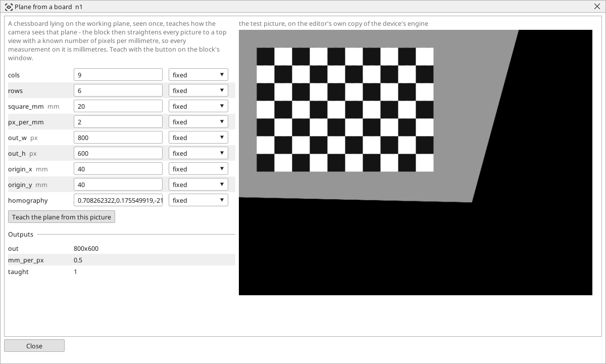

<!-- AUTOMATICALLY GENERATED from schema/visu-vision.yaml (tools/gen_vision.py) -->

# Plane from a board

**Geometry** · in the trade: *camera-to-world calibration, plane rectification (homography)* · in a project file: `world`

A chessboard lying on the working plane, seen once, teaches how the camera sees that plane - the block then straightens every picture to a top view with a known number of pixels per millimetre, so every measurement on it is millimetres. Teach with the button on the block's window.

{: .sb-center}

Teaches the camera what the working plane looks like - the belt, the table, the tray - from one picture of a chessboard lying flat on it. From then on the block draws every picture as a top view of that plane in which one millimetre is a known number of pixels (`px_per_mm`), whatever angle the camera looks from and wherever it stands. Every measurement on the top view is in millimetres without a ruler in the picture: its *mm_per_px* feeds the **scale** input of the measuring blocks and the [Scale](vision-scale.md) block.

Lay the board on the plane, set its inner corners (`cols` x `rows` - a board with 10 x 7 squares has 9 x 6 inner corners) and the size of one square, take a picture and press **Teach the plane from this picture** in the block's window. The window shows the straightened picture; *taught* comes on and the mapping (nine numbers) is saved in the project. Before the teach the picture passes through unchanged.

`out_w` and `out_h` are the size of the top view, `origin_x` and `origin_y` say where the board's first inner corner (the top-left one as the camera sees it) lands in it - move them when a part lies outside the view. Teach again when the camera is moved.

## Typical uses

- measurements in millimetres from a camera at an angle
- one calibration for every gauge on the plane
- a top view of the belt for the operator

## Inputs

| Input | Type | Meaning |
|:---|:---:|:---|
| `src` | picture | the picture of the plane, at any angle |

## Outputs

| Output | Type | Meaning |
|:---|:---:|:---|
| `out` | picture | the top view of the plane, out_w x out_h pixels, px_per_mm pixels per millimetre |
| `mm_per_px` | number | the top view's scale (1 / px_per_mm) once taught, 0 before - wire it into a scale input |
| `taught` | yes/no | a plane has been taught; off while the picture passes unchanged |

A number or a yes/no output goes into a variable of the PLC program (right-click the block on the Vision page, *Result ... into*); a text output into a STRING variable; a picture or a list of objects into the next block.

## Settings

| Setting | Range | Default | Unit | Meaning |
|:---|:---:|:---:|:---:|:---|
| `cols` | 2 .. 30 | 9 |  | the board's inner corners across |
| `rows` | 2 .. 30 | 6 |  | the board's inner corners down |
| `square_mm` | 0.1 .. 1000 | 10 | mm | one square of the board |
| `px_per_mm` | 0.1 .. 100 | 4 |  | how many pixels one millimetre gets in the straightened picture |
| `out_w` | 8 .. 4096 | 800 | px | the straightened picture's width |
| `out_h` | 8 .. 4096 | 600 | px | the straightened picture's height |
| `origin_x` | 0 .. 10000 | 20 | mm | where the board's first corner lands in the straightened picture |
| `origin_y` | 0 .. 10000 | 20 | mm | where the board's first corner lands in the straightened picture |
| `homography` | text | (empty) |  | the taught mapping - nine numbers (set by the teach) |

Every number and yes/no setting can be read from a **variable** before each run instead of being fixed - pick it in the list beside the setting (the variable column of [the block's window](vision.md#the-blocks-window)). A text setting takes a STRING variable the same way.

## On the block's window

- **Teach the plane from this picture** - a button in the window: with the chessboard lying flat on the working plane it computes the mapping from `cols`, `rows`, `square_mm`, `px_per_mm` and the origin, and stores it in `homography`.

---

Every block: [Vision blocks](vision-blocks.md) · how a program is drawn and what its window shows: [Vision](vision.md) · the cameras: [Cameras](cameras.md)
