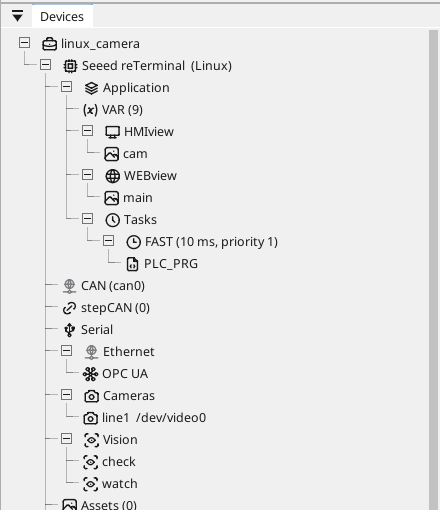
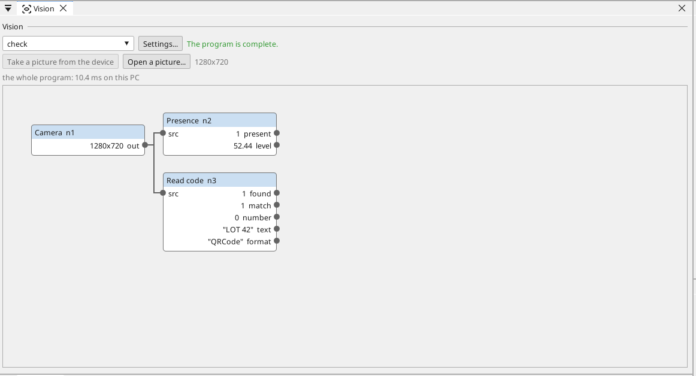
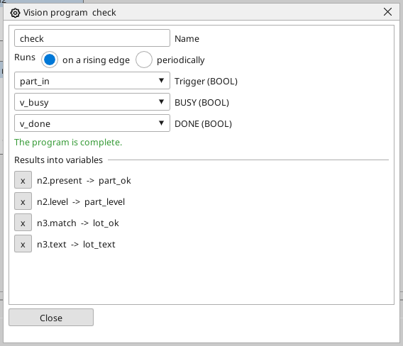
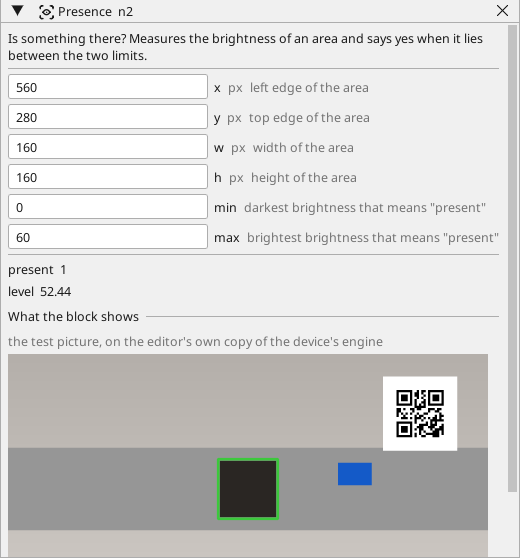

# Vision

A Linux device can **look and decide**: is the part there, is it the
right colour, where is its edge, what does its code say. The answers
are ordinary variables - the PLC program, the screens, Modbus, OPC UA
and MQTT use them like any other.

A vision program is drawn, not written: a chain of blocks - the camera,
what is done with its picture, what is measured - and every block has
its own window with its settings and the picture it makes.

!!! note "64-bit Linux devices only"
    Vision runs on the Linux runtime of a **64-bit** device - the
    reTerminal, a Raspberry Pi 4 / 5, a CM4 / CM5, a PC-class device -
    with a camera of the project (see [Cameras](cameras.md)). The
    STM32MP1 device is too slow for it and has none. A project for
    another board that carries a vision program is refused at build.

## Adding a vision program

The vision programs have their own node in the tree, **Vision**, right
under the device beside **Cameras**. Right-click it → **Add vision
program**. A new program starts with its camera block, set to the
project's first camera.

{: .sb-center}

Click the program to open its page.

{: .sb-center}

- **Click a block** in the Toolbox on the right to add it — the
  groups fold and unfold like the ladder's.
- **Settings...** opens the program's window: its name, when it runs
  (on a rising edge of a variable, or every so many milliseconds),
  BUSY and DONE, and the results — which output goes into which
  variable. The page itself is the graph, with as much room as the
  screen gives.

{: .sb-center}

- **Drag from an output** (the dots on the right of a block) **to an
  input** (the dots on the left) to connect them. A picture goes into a
  picture input, a number into a number input.
- **Right-click an input** to disconnect it. An input nothing feeds is
  drawn red, and the page says what is missing:
  *Not complete: ...*. A complete program says *The program is
  complete.*
- **Drag a block** to move it, **right-click** it to remove it or to
  send one of its results into a variable.

## Every block has its own window

**Double-click a block** to open its window: every setting with its
unit and what it means, the values the block produced, and **what the
block shows** - its picture, or for a measuring block the picture it
measured with its area framed: green when the answer is *yes*, red when
it is *no*. Several windows can be open at once.

{: .sb-center}

**Teach by hand:** a block that looks at an area takes it from a
**drag on its picture**, and a colour check (or a colour range) takes
its colour from a **right click on a point** of the picture - the
label, the cap, the mark it must recognise. The numbers in the window
follow, and can still be typed.

The pictures need a **test picture**: **Take a picture from the device**
(the camera the program reads, over the network), or **Open a
picture...** from a file. The editor then runs the program on it with
its own copy of the device's vision engine - what the windows show is
what the device will compute. Change a setting and the pictures and
values follow at once.

**Online**, the windows show the device's own run instead: its picture
of every block, its values, and how many times the program ran.

Every block and all its settings are listed in
[Vision blocks](vision-blocks.md).

## The ready tools

Four blocks do a whole check on their own:

| Tool | Answers | Typical use |
|:---|:---|:---|
| **Presence** | *present* (yes/no) and the *level* of brightness in an area | is the part in position, is the lens covered |
| **Colour check** | *match* (yes/no) and the *share* of the area in the chosen colour | the right cap, the right label |
| **Edge position** | *found* (yes/no) and the *position* of the first edge in an area, in pixels | where the material ends, a mark on a web |
| **Read code** | *found*, *match* (the expected text), the code's *text* (into a STRING variable), the code as a *number* when it is one, and the *format* that was read | a QR code, a barcode (EAN, UPC, Code 128, Code 39, ITF, Codabar, GS1 DataBar), a DataMatrix, a PDF417 or an Aztec code on the part — or *any* of them at once |

Everything else - cropping, colour ranges, thresholds, filters,
counting objects, turning pixels into millimetres - is there to build
a check of your own.

## A piece of ST

When the blocks do not have the calculation you need, the **ST code**
block takes a few lines of ST - the same language as the PLC program.
Its inputs are `a`, `b`, `c`, `d` (numbers) and `p`, `q` (yes/no), its
outputs `y1`..`y4` (numbers) and `r1`, `r2` (yes/no); a pin you do not
connect reads 0. Locals go in `VAR ... END_VAR` at the start; loops and
conditions work as in a program:

```
VAR i : INT; END_VAR
y1 := a * 2.0 + b;
r1 := a > 50.0 AND p;
```

The code is compiled the moment you leave the box - the window says
*Compiles.* or names the line - and it runs on the device inside the
vision program, on the device's own ST engine.

## Millimetres, not pixels

A **Ruler** block turns the picture's pixels into millimetres: drag along
a known length on its picture - the part's width, a printed mark - and
type what it really is. Its *mm per px* goes into a **Scale** block's
`factor_in`, and every pixel measurement wired through the Scale comes
out in millimetres. A camera that looks at the belt from the side sees
a rectangle at an angle: **Straighten** takes its four corners by four
clicks on the picture and draws it straight, so the blocks after it
measure a plane, not a perspective. A **Plane from a board** block does
both at once from one chessboard (see [Coordinates](#coordinates)).

## Settings from variables

Any number or yes/no setting of a block can come from a **variable**
instead of being fixed: pick the variable in the small list beside the
setting (*fixed* is the other choice). The device reads it **before
every run**, kept inside the setting's range. A recipe or the PLC
program then changes the check - another product, another area,
another limit - without a new vision program. A **text** setting -
the expected text of Read code, the labels of a model - comes from a
**STRING** variable the same way: the lot code of a recipe is the code
the camera must read.

A project holds up to **32 vision programs**, a program up to **256
blocks** and **128 results**.

## Finding objects

Some blocks give a **list of objects** rather than a number: **Find
objects** (the separate white areas of a black-and-white picture) and
**Find circles**. Every object has its centre, its frame, a radius, an
angle and an area, and the list is sorted - the largest first, or left
to right, or top to bottom - so *object 0* always means the same one.

- **Pick object** gives the numbers of one object of the list - its
  position and size go into variables like any result.
- **Crop to object** keeps the frame around one object: the blocks
  after it look only where the part really is, wherever it lies on
  the belt.
- **Check objects** takes a list and says whether there are as many
  as there should be and every one is the right size - parts on a
  tray, holes in a plate, pills in a blister - with the count, the
  number of bad ones and the smallest, largest and mean area.
- **Find lines** gives the straight lines of an edge picture - the
  edge of a sheet, a seam - each with its angle and its length, the
  longest first.

**Find pattern** looks for a taught picture - a mark, a logo, the part
seen from above - and gives the matches with their score. Teach it by
**dragging over the part** on the block's picture: the cut-out becomes
a picture of the project, and the block finds it wherever it appears,
with *min score* saying how alike a place must be.

The window of a block that finds objects shows each one framed and
numbered on the picture it was found in (a match with its score).

## Measuring

The measuring blocks answer in pixels, and in millimetres as soon as a
**scale** is wired into them (mm per pixel — from the Ruler, or from
the Plane block once a board has been taught). Every one takes a
**tolerance** — *min* and *max*, 0 = no limit — and answers *ok*: a
value outside the pair is a failed check, never a fault.

- **Fill level** — the first change of brightness down (or up) a
  window, averaged across its width: the level of a liquid in a bottle,
  of a powder in a jar, as pixels from the window's bottom edge.
- **Circle (fit)** — an edge on every ray of a ring and a circle
  through them without the stray points: diameter, centre, roundness.
- **Line (fit)** — an edge on every scan across a window and a line
  through them: angle, position, straightness. **Angle** — between two
  such lines. **Distance of points** — between any two points other
  blocks found.
- **Caliper** — every edge along a line: width, count, pitch, each edge
  as an object for the geometry blocks.
- **Part in place** — the largest dark (or light) object in a window,
  judged by where it sits and how big it is: a cap on a bottle, a seal
  in its seat, a label on its place.
- **Laser line profile** — a cheap line laser shines a line across the
  part, the ordinary camera sees it from an angle, and the line's bend
  is the height profile: the height of a step, the depth of a groove,
  the fill of an opaque jar. Teach the baseline on the empty plane, set
  the millimetres per pixel once with a block of known height, and the
  block answers height, its extremes, the width of what stands up, and
  the profile as objects.
- **Colour of object** — the mean hue of every found object, and the
  ones inside a hue range kept: red, green and blue cubes sorted in one
  pass.

## Coordinates

A part on a belt never lies exactly where it lay when the check was
drawn. Two blocks of the **geometry** group take care of that, and every
block after them keeps its windows where they were drawn.

- **Fixture** — drag over the part on the block's picture once: the
  block remembers the part's picture and where it was. On every later
  picture it finds the part again and shifts the whole picture so the
  part sits where it was taught — a window drawn on the cap finds the
  cap wherever the bottle stopped. *max angle* lets the part lie
  turned too (the block turns the picture back; 0 = the part never
  turns, the quickest). It answers *found*, the shift and the turn it
  undid, and how alike the part looked (*score*). A part it does not
  find leaves the picture as it was, with *found* off.
- **Plane from a board** — lay a chessboard flat on the working plane
  (the belt, the table), set its inner corners and the size of a square,
  and press *Teach the plane from this picture* on the block's window.
  From then on the block draws every picture as a top view in which
  one millimetre is a known number of pixels, whatever angle the
  camera looks from. Its *mm per px* output feeds the **Scale** block
  and the *scale* input of every measuring block, so a length, a
  diameter or a level reads in millimetres without a ruler in the
  picture. The origin is the board's top-left inner corner as the
  camera sees it; *origin* says where that corner lands in the top
  view. Teach it once; the mapping is saved with the project.

The **Laser line profile** teaches the same way: with nothing under the
laser, press *Teach the baseline from this picture* and the line on the
empty plane becomes the zero every height is measured from.

## The whole toolbox

The Toolbox holds 79 blocks, grouped the way a person thinks about a
picture; every one is a row of the same table and has its window, and
[Vision blocks](vision-blocks.md) lists them all with their settings.
In short:

- **Filters** - blur, Gaussian, median, *Smooth keep edges* (noise goes,
  edges stay), *Stretch contrast* and *Local contrast* (a dull or unevenly
  lit picture becomes a clear one), *Gamma*, *Sharpen*, *Difference* and
  *Motion* between two pictures, *Combine pictures* (add, subtract, AND,
  OR, the darker, the lighter, a blend) and *Mask* (a shape found earlier
  cuts out what a later block may see).
- **Colour** - grayscale, *One channel* (the red, the saturation, the
  lightness ... as a gray picture), *Colour range*, *Threshold*, the
  *Automatic* and the *Adaptive threshold* (each point against its own
  neighbourhood - a shadow across the part does not matter), *White
  balance* (a yellowish lamp stops shifting the colours), *Invert*.
- **Shapes** - erode, dilate, open, close, *Top-hat* and *Black-hat*
  (only the small bright or dark details), *Outline*, *Fill holes*, the
  *Distance map*.
- **Edges** - *Edges* (Canny), *Gradient* (Sobel, Scharr), *Laplacian*.
- **Geometry** - crop, resize, *Halve*, rotate by quarters, *Turn and
  shift* by any angle, flip, *Straighten* a rectangle seen at an angle,
  *Unroll ring* (a label round a bottle, the teeth of a gear, a dial
  become a straight strip), *Lens correction* (the barrel of a wide lens
  taken out - hold a chessboard in front of the camera, take a picture
  and press **Calibrate from this picture** on the block; the eight
  numbers fill in).
- **Learned models** - *Classify (model)* and *Detect (model)*, a
  trained ONNX network of the project (below).
- **Finding objects** - *Find objects*, *Find circles*, *Find lines*,
  *Find corners*, *Fill from point* (the whole part under a point,
  whatever its outline), *Find pattern* (a taught picture where it lies),
  *Find by features* (the taught picture even turned, nearer or farther -
  a logo, a printed mark, a part at any angle), *Find markers* (ArUco and
  AprilTag squares with a number - a cheap, exact way to know where a
  fixture, a tray or a robot is), *Filter objects* (keep the ones that
  look right by area, roundness, elongation, solidity), *Object shape*,
  *Nearest object*, *Check objects*, *Pick object*, *Crop to object*.
- **Measurements** - brightness, the share of white, *Brightness
  statistics* (mean, darkest, brightest, spread), *Histogram*,
  *Sharpness* (a camera knocked out of focus, a fogged lens), *Blobs*,
  *Caliper* (every edge along a line - the width of a part, the gap
  between two, the number of pins), *Distance* between two points,
  *Compare with taught* (an area against the same area on a good part -
  a missing print, a wrong label, a scratch), *Scale*, *Ruler*, *In
  range*.
- **Ready tools** - *Presence*, *Colour*, *Edge position*, *Read code*,
  *Match shape* (is one of the found objects the taught shape, whatever
  its size or turn).

## Learned models

Everything above is a rule you can name: a shade, a shape, a mark. Some
things have no rule - a scratch of any shape, a part that is "wrong" in
a hundred ways, mixed products on one belt, a person in the cell. For
those there are two blocks that run a **trained neural network**, an
ONNX model you import into the project as a file:

- **Classify (model)** says which of the model's classes the picture is
  - good / bad, which of five products, full / empty - with the class,
  its label and how sure the model is.
- **Detect (model)** finds every object the network knows (YOLO or SSD
  models) and gives them as a list with the class, the score and the
  place, ready for Pick object, Nearest object and the rest.

The model is not trained on the device. It is trained on a PC from
pictures you collected (a few hundred good ones and bad ones are a
start), or taken from a model zoo, and exported as ONNX. The block's
settings say what the model expects - its input size, whether the
picture goes in as 0..1, RGB or BGR - and the labels are its classes
in order. On a Raspberry Pi 4 a small classifier takes tens of
milliseconds, a small detector a few hundred: run it on a trigger, on
a crop, not ten times a second on the whole picture.

One model ships ready to use: the
[People counter](example-people-counter.md) example carries YOLOX-Nano,
a 3.6 MB network that knows 80 everyday classes (person, car, bottle,
chair ...), with the block's settings already right for it — its raw
export keeps the boxes in grid units, which is what the *yolox* layout
decodes. Open the example, change *only* to the class you want, and the
same block counts cars or bottles.

!!! note "The model's licence is yours"
    OpenCV runs any ONNX model; the model file carries its own licence.
    MobileNet, EfficientDet and models you train yourself are free to
    ship; the Ultralytics YOLOv5 / v8 weights are AGPL, which a product
    cannot carry without their commercial licence. Check before you
    build a product on a downloaded model.

Every block that works with a **taught picture** - Find pattern, Find by
features, Compare with taught, Match shape - is taught the same way: drag
over the part on the block's picture. Compare with taught takes the
dragged rectangle as its area at the same time. A block with a **line** -
Ruler, Caliper - takes the line by a drag, too.

## When it runs

- **On a rising edge** of a BOOL variable - the PLC way: the program
  sets *part_in* when the part is in position, and the vision program
  looks once.
- **Periodically**, every so many milliseconds, for a check that
  watches all the time.

Two optional BOOL variables make a handshake a rung can wait on:
**BUSY** is on while the program runs, **DONE** comes on when its
results are written, and both go off at the next trigger.

## Results into variables

Right-click a block and pick which of its outputs goes into which
variable (a number or a BOOL; a text result into a STRING variable). The results are written only after a
run that succeeded - a program that could not look (no picture, the
camera unplugged) writes nothing and says why on the device's console
and in its diagnostic buffer.

## The control comes first

A vision program runs on the device **below the PLC**, on its own
thread, away from the core the cycle and the EtherCAT line use. When
the device is busy, a picture waits - the cycle never does. A camera
that stops giving pictures is a failed run, never a check on an old
picture.
