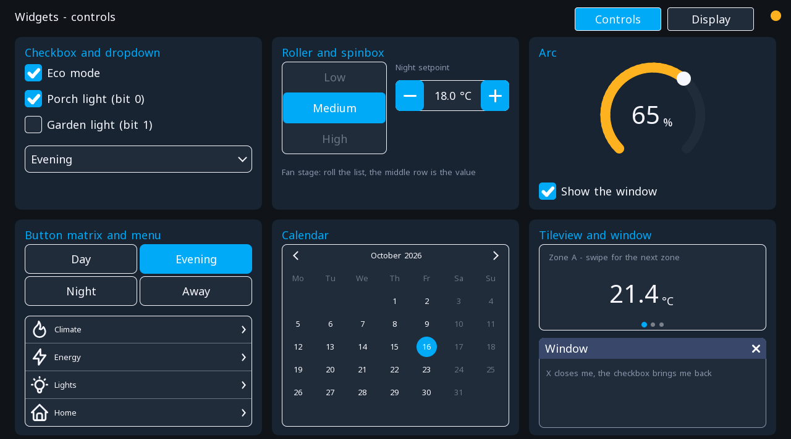
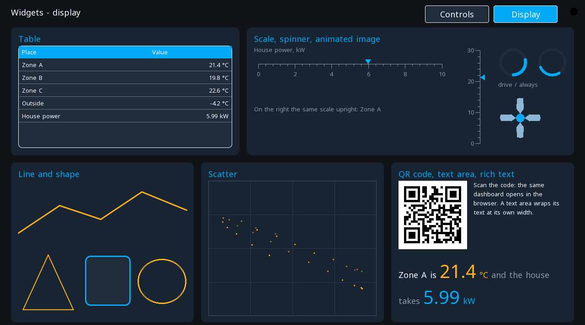

# Visualisation

A ctrl32 project draws its screens twice over, from one set of variables: on
the board's own display, and in a browser. Both are drawn in the same
editor, both travel in the same file, and neither is a picture of the
other.

| | |
|:---|:---|
| [HMIview — the panel screen](hmiview.md) | the display in the equipment's door: touch, colour, redraw cost |
| [WEBview — in a browser](webview.md) | the same project on a phone or laptop, served by the board itself |
| [Screens and widgets](widgets.md) | the reference: every widget and every property |

{: .sb-center}

---

## The widget library

Every screen is built from the same widgets, sorted in the editor's
Toolbox into six groups — basic, controls, indicators, charts, layout and
text. Each family has its page:

| | |
|:---|:---|
| [Controls](widgets-controls.md) | buttons, switches, sliders, inputs, checkboxes, dropdowns, rollers, spinboxes, button matrices, arcs, calendars, menus |
| [Indicators](widgets-indicators.md) | lamps, bars, gauges, tables, scales, spinners, QR codes |
| [Text and values](widgets-text.md) | labels, values, text areas, rich text |
| [Charts](widgets-charts.md) | energy flow, columns, rings, sparklines, scatter |
| [Trends and alarms](widgets-data.md) | trends and the alarm table |
| [Containers](widgets-containers.md) | panels, lists, tabs, popups, tileviews, windows |
| [Images and icons](widgets-graphics.md) | images, icons, lines, shapes, animated images |

The home dashboard of the net32 showcase carries the newer widgets on two
screens of its own — the controls and the display widgets, every one
wired to a live value of the house:

{: .sb-center}

{: .sb-center}

---

## The screens are data

This is the idea the whole product rests on. Screens are not compiled
into the firmware — they are a file the board reads.

Changing a screen means uploading a file, not building and flashing
firmware. A colour, a label, a whole new page: upload, and the board
shows it. The firmware is untouched, and there is nothing to go wrong
in it.

The same file feeds three renderers — the board, the editor's canvas and
the browser — which is why the editor shows you exactly what the glass
will show, and why the browser agrees with both.

---

## Which view for whom

**The board** is for the person standing at the hardware. It is always
there, it works when the network does not, and it is the only view during
commissioning when nothing else exists yet.

**The browser** is for everyone else: the operator checking from the
other end of the hall, the maintainer at home at three in the morning,
the manager who wants a number. No app to install, nothing to configure
on the device.

Most projects want both. A project with no browser screens serves the
board's screens to the browser as well, so you get the second view
without drawing anything twice.

---

## One rule above the rest

**Set a deadband on every analog variable.**

Without it, a measurement reports every flicker of its last digit. The
board repaints, the WebSocket floods, a phone's battery drains — and
nobody learns anything from a temperature quoted to a hundredth of a
degree.

It costs one field in the variable table and it is the single most effective
thing you can do for how a setup feels to use. See [Variables](variables.md).

---

The short overview — what you draw, where it runs and why there is no
code — lives at [ctrl32.com/hmi](https://ctrl32.com/hmi/).
