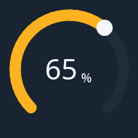

# arc

**Controls** · in a project file: `type: arc`

A round knob: drag along the track to set a value read at a glance.

{: .sb-center}

## Properties

| Property | Type | Default | Meaning |
|:---|:---:|:---:|:---|
| `tag` | variable | required | what it writes |
| `min` | number | `0.0` | the bottom of the range |
| `max` | number | `100.0` | the top of the range |
| `start_angle` | integer | `135` | where the track starts, degrees (0 = 3 o'clock, clockwise) |
| `sweep` | integer | `270` | how long the track is, degrees |
| `thickness` | integer | `0` | the track's width; 0 = from the size |
| `show_value` | yes / no | yes | the number in the middle |
| `font` | font | - | how the number is drawn |

Every widget also has its place (`x`, `y`, `w`, `h`), a `style`, `visible_if` / `enabled_if` and the state colours and motion of [States and motion](states-motion.md) - see the [Property reference](widgets.md).

## Description

A round knob: a track, the value as an arc in the accent and a handle
at its end. Dragging along the track writes the value; the number
sits in the middle with its unit.

A dimmer, a volume, a valve opening — values a person sets by feel
and reads at a glance. Where the exact number matters more than the
feel, the `spinbox` is the better tool.

```yaml
- type: arc
  rect: [966, 96, 180, 180]
  tag: dimmer
  min: 0
  max: 100
  thickness: 16
```

With a knob, a press on a focused arc enters edit and a turn walks its
range in fifty steps; a screen that is one arc starts with it focused
and turns at once.

---

Every widget of the family: [Controls](widgets-controls.md) · every widget: [Property reference](widgets.md)
