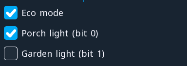

# checkbox

**Controls** · in a project file: `type: checkbox`

A box with a tick and a label that toggles a BOOL or one bit of an integer.

{: .sb-center}

## Properties

| Property | Type | Default | Meaning |
|:---|:---:|:---:|:---|
| `tag` | variable | required | what it writes |
| `text` | text | - | the label beside the box |
| `bit` | integer | `-1` | which bit of an integer; -1 = the whole value |
| `font` | font | - | how the label is drawn |

Every widget also has its place (`x`, `y`, `w`, `h`), a `style`, `visible_if` / `enabled_if` and the state colours and motion of [States and motion](states-motion.md) - see the [Property reference](widgets.md).

## Description

A box with a tick and a label. A tap toggles the variable, the accent
fills the ticked box. It says the same thing as a `switch` in less
room, and it reads naturally in a column of options: *Eco mode*,
*Porch light*, *Garden light*.

Like the switch, it can own **one bit of an integer**. The two lights
in the picture are bits 0 and 1 of one variable — one word for the
logic, the bus and the recipe, and every box writes only its own bit.

```yaml
- { type: checkbox, rect: [40, 100, 368, 36], tag: eco_mode, text: "Eco mode" }
- { type: checkbox, rect: [40, 142, 368, 36], tag: lamps, bit: 0, text: "Porch light" }
```

With a knob, a press on a focused checkbox acts exactly as a tap
would.

---

Every widget of the family: [Controls](widgets-controls.md) · every widget: [Property reference](widgets.md)
