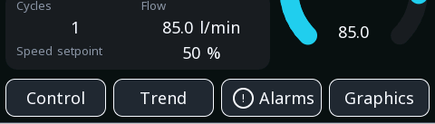

# gauge

**Indicators** · in a project file: `type: gauge`

A dial whose needle position is recognised without reading the number.

{: .sb-center}

## Properties

| Property | Type | Default | Meaning |
|:---|:---:|:---:|:---|
| `tag` | variable | required | the value |
| `min` | number | `0.0` | the bottom of the range |
| `max` | number | `100.0` | the top of the range |
| `start_angle` | integer | `135` | where the scale begins, degrees |
| `sweep` | integer | `270` | how far it goes round, degrees |
| `cache_background` | yes / no | yes | precompute the dial once at startup |
| `thickness` | integer | `0` | ring thickness; 0 = automatic |
| `needle` | yes / no | yes | draw a needle; off gives a ring |
| `show_value` | yes / no | yes | the number in the centre (Center number in the inspector) |

Every widget also has its place (`x`, `y`, `w`, `h`), a `style`, `visible_if` / `enabled_if` and the state colours and motion of [States and motion](states-motion.md) - see the [Property reference](widgets.md).

## Description

The dial. Slower to read than a bar and better at one thing: a person
who knows the equipment recognises the *position* of the needle
without reading the number at all.

**Leave `cache_background` on.** The dial — the ring, the ticks, the
gradient — is expensive to draw and never changes, so it is rendered
once at startup and reused. Turning the cache off means drawing it on
every update, and on a busy screen that is felt.

**`needle` off gives you a ring** instead: a filled arc with the value
in the middle. Cleaner, more modern, and easier to read at small
sizes. The needle is better when somebody watches for the value to
move.

**The centre number is optional** (*Center number* in the inspector).
On small glass it often crowds the dial — switch it off and let the
position speak, or place a separate `value` widget where the number
reads best. The dial in the i550 example does exactly that.

The default 135° start with a 270° sweep is the familiar shape —
bottom left, round the top, bottom right. Changing them gives you a
half dial (start 180, sweep 180) or a quarter.

A gauge bound to an analog variable without a deadband repaints
continuously and never sits still; set the deadband on the variable.

---

Every widget of the family: [Indicators](widgets-indicators.md) · every widget: [Property reference](widgets.md)
