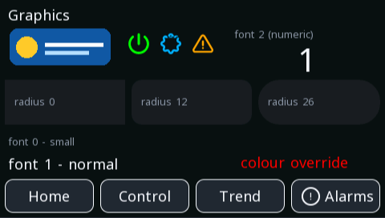

# icon

**Images and icons** · in a project file: `type: icon`

A vector glyph, sharp at any size, that can switch glyph and colour with a variable.

{: .sb-center}

## Properties

| Property | Type | Default | Meaning |
|:---|:---:|:---:|:---|
| `src` | icon_ref | required | which glyph |
| `color` | colour | - | how it is drawn |
| `tag` | variable | - | switches between the two states |
| `src_active` | icon_ref | - | the glyph when the variable is true |
| `color_active` | colour | - | the colour when it is true |

Every widget also has its place (`x`, `y`, `w`, `h`), a `style`, `visible_if` / `enabled_if` and the state colours and motion of [States and motion](states-motion.md) - see the [Property reference](widgets.md).

## Description

The one to reach for first. Icons are **vector outlines**, so they are
sharp at any size — a 16-pixel status glyph and a screen-filling
symbol come from the same entry and neither is blocky.

They also cost almost nothing: an outline is tens of bytes, where a
bitmap of the same picture grows with the square of its size. A
full-screen bitmap icon used to cost a couple of hundred kilobytes.

**With `tag`, one icon says two things.** A pump that changes glyph
*and* colour when it runs, a valve that shows open and shut, a lock
that locks — one widget, no hidden twin, nothing to keep in step.

`color` recolours the glyph: the same warning triangle in amber for a
warning and red for a fault, without a second file. With
[states](states-motion.md) the colour can follow a variable. An icon
can be turned by `rotate:` and carried round a circle by `move:` (see
the family's *Turning and circling*).

!!! tip "Icons are drawn identically everywhere"
    The board, the editor canvas and the browser all fill the same
    outlines, so what you place is what appears — including in a
    screenshot somebody sends you from the field.

---

Every widget of the family: [Images and icons](widgets-graphics.md) · every widget: [Property reference](widgets.md)
