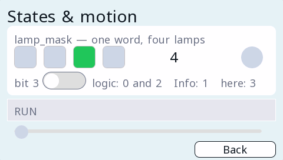

# led

**Indicators** · in a project file: `type: led`

A lamp: one variable, two colours, immediately readable.

{: .sb-center}

{: .sb-center}

## Properties

| Property | Type | Default | Meaning |
|:---|:---:|:---:|:---|
| `shape` | one of `round` / `rect` | `round` | round or rect |
| `tag` | variable | required | what it follows |
| `color_on` | colour | - | the colour when the value is true |
| `color_off` | colour | - | the colour when it is not |
| `blink_hz` | number | `0.0` | blink rate; 0 = steady |
| `bit` | integer | `-1` | which bit of an integer; -1 = the whole value |

Every widget also has its place (`x`, `y`, `w`, `h`), a `style`, `visible_if` / `enabled_if` and the state colours and motion of [States and motion](states-motion.md) - see the [Property reference](widgets.md).

## Description

The workhorse of any screen. One variable, two colours, immediately
readable. It binds a BOOL, or one bit of an integer.

**`bit` turns one integer into a row of lamps.** A status word from a
drive, a mask the logic builds, a set of flags — point four lamps at
the same variable with bits 0 to 3 and the whole word is visible at
once, with no logic between them.

**`blink_hz` earns its place on things that need attention.** A steady
red lamp and a blinking red lamp say different things, and people read
the difference without being taught. Use blinking for
"unacknowledged", steady for "still present".

A lamp with `alarm_ref:` in its state goes red exactly when the alarm
table says so — one alarm definition, two ways to notice it. A `move:`
makes a lamp a marker that walks a path as a value sweeps its range —
a tank level riding a strip. See [States and motion](states-motion.md).

**A heartbeat.** One `BLINK` on a lamp: anybody at the equipment sees
that the program runs, without a laptop. **A link lamp beside a life
counter** (or beside a bit of the other controller's clock byte):
together they say which of the two sides stopped.

!!! tip "Three states are better than two"
    A lamp does not have to be limited to on and off. With
    [states](states-motion.md) it takes a true, a false **and** an
    alarm colour, driven by a variable or by one bit — so one widget
    says running, stopped, or faulty, instead of two widgets and a
    hidden one.

---

Every widget of the family: [Indicators](widgets-indicators.md) · every widget: [Property reference](widgets.md)
