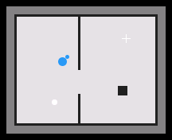

# map2d

**Images and icons** · in a project file: `type: map2d`

The robot's map - the occupancy grid from the robot's network, the robot on it, a tap a goal.

{: .sb-center}

## Properties

| Property | Type | Default | Meaning |
|:---|:---:|:---:|:---|
| `topic` | text | required |  |
| `path_topic` | text | - |  |
| `vars` | list | - |  |

Every widget also has its place (`x`, `y`, `w`, `h`), a `style`, `visible_if` / `enabled_if` and the state colours and motion of [States and motion](states-motion.md) - see the [Property reference](widgets.md).

## Description

The robot's map. The occupancy grid of the **Map topic** comes from
the robot's network through the ROS 2 node of a Linux device and fills
the element with the aspect kept — free cells light, occupied dark,
unknown grey — and the planned path of the **Path topic** is drawn
over it. The robot is drawn from the element's variables: **x** and
**y** in metres, **yaw** in radians, received from the robot's
position topic by fields. The project's goal (**goal_x**, **goal_y**)
shows as a cross.

A tap on the map places a goal marker; a **second tap on the marker**
writes `goal_x` and `goal_y` and flips **goal** — the confirm; a tap
elsewhere moves the marker. Publish `goal_x` and `goal_y` as a
`geometry_msgs/PoseStamped` by fields and the robot's navigation takes
the goal. The same in the browser.

A map element on a device without the ROS 2 node is refused at the
desk; on a panel that is not a Linux device the element draws its
word — the map is a Linux element.

---

Every widget of the family: [Images and icons](widgets-graphics.md) · every widget: [Property reference](widgets.md)
