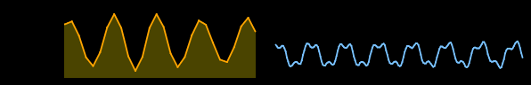

# sparkline

**Charts** · in a project file: `type: sparkline`

A small curve of one variable's recent past, to sit beside the number.

{: .sb-center}

## Properties

| Property | Type | Default | Meaning |
|:---|:---:|:---:|:---|
| `tag` | variable | required | what it draws |
| `timespan_s` | integer | `3600` | how far back it reaches, s |
| `sample_ms` | integer | `30000` | one point every, ms |
| `min` | number | - | a fixed range bottom; empty = it scales itself |
| `max` | number | - | a fixed range top; empty = it scales itself |
| `fill` | yes / no | yes | shade the area under the curve |

Every widget also has its place (`x`, `y`, `w`, `h`), a `style`, `visible_if` / `enabled_if` and the state colours and motion of [States and motion](states-motion.md) - see the [Property reference](widgets.md).

## Description

A small curve of one variable's recent past — no axes, no grid — to
sit in a card beside the number. The number says *where it is*; the
curve says *where it is going*, which is what somebody actually wants
to know about a temperature or a power.

Without `min` and `max` it scales itself to what it shows, so even a
small movement has a shape. Give it a range when the shape should say
how big the movement is.

```yaml
- { type: sparkline, rect: [420, 440, 280, 80], tag: pv, sample_ms: 90000, timespan_s: 43200 }
```

It keeps its past in the same recorder as the trends: its variable is
one of the recorded variables a project may have (see
[Limits](limits.md)).

---

Every widget of the family: [Charts](widgets-charts.md) · every widget: [Property reference](widgets.md)
