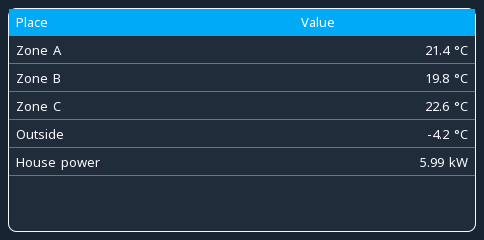

# table

**Indicators** · in a project file: `type: table`

Rows of cells, a row with a variable showing its live value as the last cell.

{: .sb-center}

## Properties

| Property | Type | Default | Meaning |
|:---|:---:|:---:|:---|
| `header` | text | - | the first row, cells separated by a vertical bar |
| `rows` | list | - | the rows: cells and an optional tag |
| `font` | font | - | how the cells are drawn |

Every widget also has its place (`x`, `y`, `w`, `h`), a `style`, `visible_if` / `enabled_if` and the state colours and motion of [States and motion](states-motion.md) - see the [Property reference](widgets.md).

## Description

Rows of cells, the header drawn in the accent. A row is its `cells` —
one text with the cells separated by a vertical bar, or a list — and a
row with a variable shows the variable's live value **with its unit**
as its last cell, right-aligned like numbers in a printed table.

| Row key | Meaning |
|:---|:---|
| `cells` | the row's fixed cells |
| `tag` | a variable whose value is the last cell |

Several values that belong together — the rooms of a house, the axes
of a gantry, the zones of an oven — read faster as a table than as the
same number of separate value widgets, and cost one widget instead of
ten.

```yaml
- type: table
  rect: [40, 100, 468, 224]
  header: "Place|Value"
  rows:
    - { cells: "Zone A", tag: temp_a }
    - { cells: "Outside", tag: out_temp }
    - { cells: [Note, "steady"] }
```

---

Every widget of the family: [Indicators](widgets-indicators.md) · every widget: [Property reference](widgets.md)
