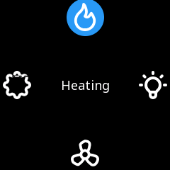

# wheel

**Controls** · in a project file: `type: wheel`

A ring of icons with captions - the home screen of a round glass with a knob.

{: .sb-center}

## Properties

| Property | Type | Default | Meaning |
|:---|:---:|:---:|:---|
| `tag` | variable | - | the selected item's value, written as the ring turns |
| `items` | list | - | the icons on the ring (the menu's rows), at most sixteen |
| `icon_size` | integer | `40` | the size of one icon |
| `font` | font | - | the caption in the centre |

Every widget also has its place (`x`, `y`, `w`, `h`), a `style`, `visible_if` / `enabled_if` and the state colours and motion of [States and motion](states-motion.md) - see the [Property reference](widgets.md).

## Description

A ring of icons with their captions — the home screen of a round glass
with a knob. The **selected item sits at the top**, the ring turns to
bring the next one there, and the selected item's caption is drawn in
the centre. The items are the menu's rows: a `text`, an `icon`, a
`target` screen and an optional `value`.

Three gestures, the same on the glass and in the browser:

- **turning** the knob, dragging a finger along the ring or tapping an
  icon **selects** — the item's `value` (its position when it has
  none) is written to the variable at once, so the program sees the
  selection live;
- **pressing** the knob, tapping the centre or tapping the selected
  icon a second time **activates** — an item with a `target` opens
  that screen.

Four to eight items read well; sixteen is the limit. The wheel takes
the knob's turns directly while it has the focus — it is the thing
being turned.

```yaml
- type: wheel
  rect: [0, 0, 240, 240]
  tag: page
  icon_size: 40
  items:
    - { text: "Heating", icon: flame, target: heating }
    - { text: "Light", icon: bulb, target: light }
    - { text: "Fan", icon: propeller, target: fan }
    - { text: "Setup", icon: settings, target: setup }
```

---

Every widget of the family: [Controls](widgets-controls.md) · every widget: [Property reference](widgets.md)
