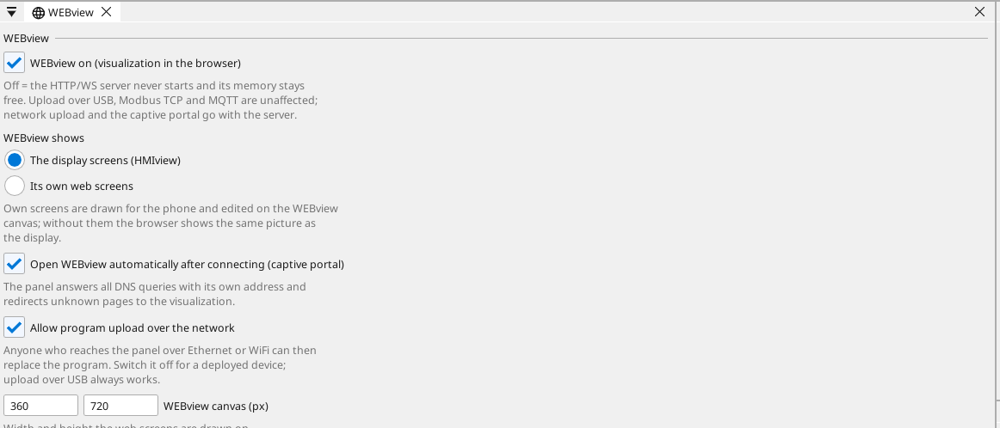

# WEBview

Every ctrl32 board serves its own visualisation to a browser. Type the
board's address into a phone, a tablet or a laptop and the equipment is
there — the same variables, the same values, live. Type it **with the
scheme**: `http://192.168.0.31` — a modern browser quietly upgrades a
bare address to https, and the panel's pages are deliberately plain
(the error that upgrade produces is in
[Troubleshooting](troubleshooting.md)).

Nothing is installed on the phone. No app, no account, no cloud. The page
comes from the board, over your own network.

---

## What it is, and what it is not

**It is** a second view of the same project. You draw it in the same
editor, from the same variables, and it uploads in the same file as
everything else.

**It is not** a picture of the board's screen being streamed. The
browser draws the widgets itself, from the same data the board draws
from. That is why it works in a real setup with a weak network and no
graphics power to spare: what crosses the wire is a handful of numbers,
not an image.

The page is written from scratch — plain TypeScript on a Canvas, no
framework — and comes to **under 20 kB compressed**. On a phone over
mobile data it loads in a blink.

---

## Two screens, or one

A project can carry **[HMIview](hmiview.md) screens** (for the board's
own display) and **WEBview screens** (for the browser), and they are
drawn separately for
a simple reason: a 4.3" board in landscape and a phone held upright are
not the same canvas.

| | HMIview | WEBview |
|:---|:---|:---|
| drawn for | the board's display | a phone, tablet or laptop |
| typical shape | landscape, fixed size | portrait, whatever the visitor has |
| who sees it | whoever stands at the equipment | whoever has the address |

A project with **no** WEBview screens serves the HMI screens instead — so
a headless controller with no display still has a full visualisation, and
you get one without drawing anything twice.

The choice is explicit in the editor: the WEBview page asks what the
browser shows — *the display screens* or *its own web screens* — and
picking its own creates the first web screen and opens it on the canvas.

{: .sb-center}
Switching back asks before deleting anything you drew.

!!! tip "Design the phone view for one job"
    The panel screen is where somebody sets up the equipment. The phone is
    where somebody checks it from the other end of the hall. A big
    number, the state, and the two buttons that matter beats a faithful
    copy of the board every time.

---

## How it stays cheap

The board is a small computer with a setup to run. The WEBview is
built so that watching it costs almost nothing:

- **The configuration is fetched once**, pre-compressed, when the page
  loads.
- **Only changed values** go over the WebSocket after that, at 5–10 Hz.
- **The browser subscribes to the screen it is showing** — values behind
  other screens are not sent at all.

!!! warning "Deadband is what makes this work"
    An analog variable without a deadband reports every flicker of its last
    digit. That floods the WebSocket, wakes the browser hundreds of times
    a second and drains a phone battery to no purpose — a temperature
    reported to a hundredth of a degree tells nobody anything.

    Set a deadband on every analog variable. See [Variables](variables.md).

---

## Writing from the browser

A button on a WEBview screen does not write into a variable directly. It
sends a **command**, and the board decides whether to accept it.

That distinction matters when the visitor is a phone on the works WiFi:
the board stays in charge of its own variables, and a page open in somebody's
pocket cannot write whatever it likes into the equipment.

---

## How many people can watch

| Board | Viewers |
|:---|:---:|
| ESP32 | 2 (the declared limit) |
| STM32F7 | 1 |
| node (ESP32-C3 / C6) | 1 |
| Linux runtime | 16 |

A viewer beyond the limit is refused; the page retries and gets in when
somebody else closes theirs.

These numbers are small on purpose. Each viewer costs RAM the equipment
needs for its own work, and ctrl32's rule is **logic before
communication before graphics**: under load, a frame is dropped, never a
cycle.

!!! danger "Do not put a board on the internet"
    There is no TLS. On the S3 it would eat the RAM the setup needs,
    and a certificate on an industrial device nobody maintains is worse
    than none.

    A board belongs on its own network. If somebody needs to
    see it from outside, that is a VPN's job — not a port forward.

---

## Getting to it

Once the board is on the network, open its address in a browser. The boot
log prints both the IP address and an `.local` name, so you rarely have
to remember the number. A Linux device serves on port **8080**:
`http://<address>:8080`.

A board with WiFi can also make **its own access point** — no
infrastructure at all, the phone connects to the board directly. That is
often the fastest way to commission a setup standing in a hall where
the network does not reach yet.

---

## Uploading over the network

The same connection carries new screens. Once a board is reachable, the
editor uploads to it directly — no cable, no walk to the equipment.

The upload goes into the **inactive slot**, the checksum is verified, and
only then does the board switch over. If anything goes wrong, the old
version keeps running. See [Download to the board](deploy.md).

A project can switch that off (`network: { upload: false }`) for an
installation where nobody should be able to change the screens from a
laptop on the same network.

---

## Turning it off entirely

A board that reports to a SCADA over Modbus TCP or MQTT may not need a
browser page at all. The WEBview page in the editor has a switch for
that: with **WEBview off** the board never starts its HTTP/WS server —
no pages, no captive portal, no network upload — and the memory the
server would take stays with the program.

Everything else is untouched: the network still comes up, Modbus TCP,
MQTT and time sync keep running, and uploading over USB always works.
Turn the switch back on and upload, and the pages are back.

---

## What the browser does not do

The WEBview draws screens and exchanges values. It does not run your
logic — that runs on the board, in the PLC cycle, whether anybody is
watching or not.

Close the browser and it carries on exactly as before. That is
the whole point: the visualisation is a window, never a dependency.
