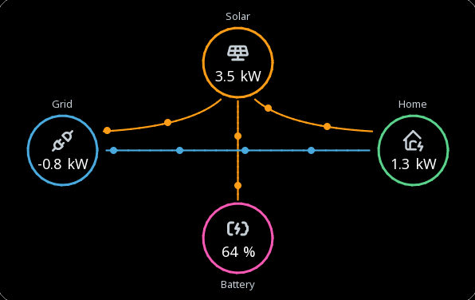
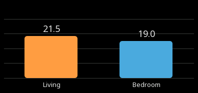
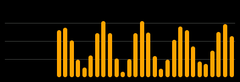
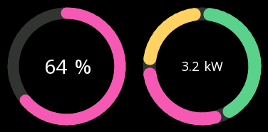
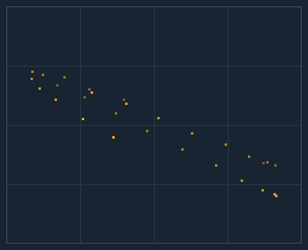

# Charts

Five widgets that turn numbers into a picture: an energy flow, columns, a
ring, a small curve and a cloud of points.

A [trend](widgets-data.md#trend) answers *what happened over time*. These
answer the questions a dashboard asks: *where is the energy going*, *which
room is warmest*, *how full is the battery*, *does one value follow
another*.

---

{: .sb-center}

## `energy_flow`

| Property | Type | Default | Meaning |
|:---|:---:|:---:|:---|
| `nodes` | list | | the circles, at most 8 |
| `links` | list | | the lines between them, at most 12 |
| `max` | number | 10 | the value at which the dots run fastest |
| `font` | font | | how the values are drawn |

Circles with an icon, a value and a name, joined by lines along which
dots run **in the direction the energy flows** — solar, grid, battery and
the house in one picture.

Each node shows its own variable. Each link has a variable whose
**sign is the direction** (positive = from `from` to `to`) and whose size
sets the speed; a link at zero stands still and dims. Feeding the grid
and drawing from it is one link and one signed value — the dots turn
round on their own.

| Node key | Meaning |
|:---|:---|
| `name` | what the links call it |
| `x`, `y` | its centre, in the widget's frame |
| `size` | the circle's diameter; 0 = from the widget |
| `icon` | the glyph in the circle |
| `tag` | the value it shows |
| `color` | the circle and its dots |
| `label` | the name under it |

| Link key | Meaning |
|:---|:---|
| `from`, `to` | the two nodes, by name |
| `tag` | the signed flow |
| `color` | the line and its dots |

```yaml
- type: energy_flow
  rect: [20, 20, 580, 360]
  max: 5
  nodes:
    - { name: solar, x: 290, y: 70, size: 90, icon: solar-panel, tag: pv, label: "Solar" }
    - { name: home, x: 510, y: 180, size: 90, icon: home-bolt, tag: load, label: "Home" }
    - { name: grid, x: 70, y: 180, size: 90, icon: plug-connected, tag: grid, label: "Grid" }
  links:
    - { from: solar, to: home, tag: pv_home }
    - { from: grid, to: home, tag: grid }
```

!!! tip "Behind glass"
    An energy flow looks best over a picture of the house, on a
    translucent [`panel`](widgets-containers.md#panel): set the panel's
    `opacity` and the photograph shows through the card.

---

## `bar_chart`

{: .sb-center}

| Property | Type | Default | Meaning |
|:---|:---:|:---:|:---|
| `series` | list | | one column per variable |
| `tag` | variable | | the variable of a history chart |
| `history` | yes/no | no | columns of the variable's past |
| `sample_ms` | ms | 3600000 | one column of the history |
| `bars` | number | 24 | how many columns of history |
| `min`, `max` | number | 0, 100 | the scale |
| `show_value` | yes/no | yes | the value over each column |
| `font` | font | | how values and labels are drawn |

Columns, in one of two ways:

- **one column per variable** of `series` — the rooms' temperatures, the
  three phases, the consumers of a house — each in its colour with its
  label under it;
- **the history of one variable** with `history: true` — one column per
  `sample_ms`, the last `bars` of them: every hour's energy of the day.

{: .sb-center}

```yaml
- type: bar_chart
  rect: [630, 20, 380, 170]
  min: 0
  max: 30
  series:
    - { tag: room1, color: "#FF9F43", label: "Living" }
    - { tag: room2, color: "#4EA8DE", label: "Bedroom" }
- { type: bar_chart, rect: [630, 210, 380, 120], tag: pv, history: true, sample_ms: 3600000, bars: 24, min: 0, max: 8 }
```

---

## `donut`

{: .sb-center}

| Property | Type | Default | Meaning |
|:---|:---:|:---:|:---|
| `tag` | variable | | the value of a single ring |
| `series` | list | | the slices |
| `min`, `max` | number | 0, 100 | the range of a single ring |
| `thickness` | px | 0 | the ring's width; 0 = a quarter of the radius |
| `show_value` | yes/no | yes | the value in the middle |
| `font` | font | | how the value is drawn |

A ring, in one of two ways:

- **one value** fills the ring from `min` to `max` and stands in its
  middle — a battery's charge, a tank, a share in per cent;
- **slices** with `series`: the ring is cut in the ratio of the
  variables, each in its colour — where the house's power goes, what
  the solar panels feed. The middle then shows their sum.

```yaml
- { type: donut, rect: [20, 410, 170, 170], tag: soc, min: 0, max: 100, thickness: 16 }
- type: donut
  rect: [210, 410, 170, 170]
  thickness: 18
  series:
    - { tag: pv_home, color: "#5BD18B", label: "Home" }
    - { tag: pv_bat, color: "#F15BB5", label: "Battery" }
    - { tag: pv_grid, color: "#FFD166", label: "Grid" }
```

---

## `sparkline`

{: .sb-center}

| Property | Type | Default | Meaning |
|:---|:---:|:---:|:---|
| `tag` | variable | | what it draws |
| `timespan_s` | s | 3600 | how far back it reaches |
| `sample_ms` | ms | 30000 | one point every |
| `min`, `max` | number | | a fixed range; empty = it scales itself |
| `fill` | yes/no | yes | shade the area under the curve |

A small curve of one variable's recent past — no axes, no grid — to sit
in a card beside the number. The number says *where it is*; the curve
says *where it is going*, which is what somebody actually wants to know
about a temperature or a power.

Without `min` and `max` it scales itself to what it shows, so even a
small movement has a shape. Give it a range when the shape should say
how big the movement is.

```yaml
- { type: sparkline, rect: [420, 440, 280, 80], tag: pv, sample_ms: 90000, timespan_s: 43200 }
```

---

## `scatter`

{: .sb-center}

| Property | Type | Default | Meaning |
|:---|:---:|:---:|:---|
| `tag` | variable | | x - along the bottom |
| `series` | list | | y - one cloud per variable |
| `x_min`, `x_max` | number | 0, 100 | the x axis |
| `min`, `max` | number | 0, 100 | the y axis |
| `sample_ms` | ms | 1000 | one pair every |
| `points` | number | 60 | how many recent pairs it keeps |

Points of recent pairs: x is the widget's variable, y each series'
variable, sampled **together** every `sample_ms`. Where a trend shows two
values against time, a scatter shows them against each other — and a
relationship nobody would see in two curves stands out as the shape of
the cloud.

In the picture the house power is drawn against the outdoor
temperature: the colder it is, the more the house takes. A pump's flow
against its speed, a motor's current against its load and a press's
force against its stroke are the same picture.

```yaml
- type: scatter
  rect: [456, 396, 368, 296]
  tag: out_temp
  x_min: -10
  x_max: 30
  min: 0
  max: 10
  sample_ms: 5000
  points: 120
  series:
    - { tag: house_power, color: 0xFD84, label: "House power" }
```

---

## What a chart costs

The sparkline, the bar chart's history and the scatter keep their past
in the same recorder as the trends: every variable they draw is one of
the recorded variables a project may have (see [Limits](limits.md)). The
energy flow, the columns of variables and the rings draw the present only
and cost nothing beyond the widget.
