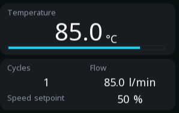

# Containers

Four widgets that hold other widgets: a panel, a list, a set of tabs and
a popup.

Containers do not show data. They give a screen structure — and structure
is what makes the difference between a screen somebody reads and a screen
somebody searches.

---

{: .sb-center}

## `panel`

| Property | Type | Default | Meaning |
|:---|:---:|:---:|:---:|
| `radius` | number | 0 | corner rounding |

A rectangle with children inside it. Children are positioned **relative
to the panel**, so moving the panel moves the group, and a panel that is
hidden hides everything in it.

That last part is the useful bit: one `visible_if` on a panel hides an
entire section of a screen — a manual-control block that only appears in
manual mode, a set of settings that only makes sense for one recipe.

**Use panels as visual grouping too.** A card around related values, with
a heading label at the top, does more for readability than any amount of
careful spacing.

!!! tip "Rounded corners are not free"
    Anti-aliased rounding is computed, not copied. On a screen with a few
    cards it is invisible; on one with thirty small rounded panels it is
    felt. Round the containers, not every element inside them.

---

## `list`

| Property | Type | Default | Meaning |
|:---|:---:|:---:|:---:|
| `item_height` | number | | height of one row |
| `inertia` | yes/no | yes | flick scrolling |

A scrolling container. The children are the rows, and only the visible
ones are drawn — so a long list costs what fits on the screen, not what
it contains.

`inertia` gives the flick-and-glide behaviour a phone has. Leave it on
for capacitive glass; on resistive touch, which wants a firm press, it is
less natural and turning it off can feel more controlled.

---

## `tabs`

| Property | Type | Default | Meaning |
|:---|:---:|:---:|:---:|
| `active` | number | 0 | which page is shown |

Several pages in one place, one visible at a time. The children are the
pages.

**Tabs versus screens** is a real decision, not a matter of taste:

- **Tabs** keep everything in one screen — the header, the navigation and
  the status stay put while the middle changes. Good for a few closely
  related views of the same thing.
- **Screens** are separate places, reached with a [`nav`
  button](widgets-controls.md). Good when the views have nothing to do
  with each other.

If somebody would say "go to the settings *page*", use a screen. If they
would say "look at the *other* tab", use tabs.

---

## `popup`

| Property | Type | Default | Meaning |
|:---|:---:|:---:|:---:|
| `radius` | number | 8 | corner rounding |

A modal window over the screen. While it is visible, **touch does not reach
what is underneath** — which is the whole point: a question that can be
ignored by pressing something else is not a question.

Popups are hidden by default and shown by binding `visible_if` to a
variable the logic sets.

**Use one for:** a confirmation the logic itself raises, a fault that
must be seen before anything else, a value that has to be entered before
a sequence can start.

!!! warning "A popup that appears while somebody is pressing something"
    If the logic can raise a popup at any moment, it can raise one under
    a finger that is already moving — and the press lands on the popup
    instead of the button. For anything raised automatically, make the
    dismiss button somewhere a finger is unlikely to already be.

---

## How nesting works

Children are positioned relative to their parent, and a hidden parent
hides its children. That is the whole model, and two things follow from
it:

**Grouping is cheap.** Wrap a section in a panel and you can move it,
hide it or disable it as a unit, without touching anything inside.

**Depth costs nothing to draw but plenty to read.** A screen four
containers deep is hard to reason about in the editor tree, and the
person maintaining it in a year will be you.

Keep the [limits](limits.md) in view: 64 widgets per screen, and the
containers count.
