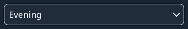
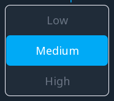
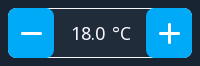
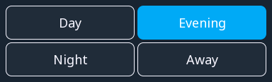
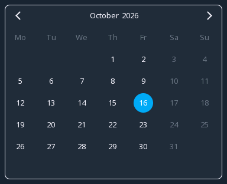
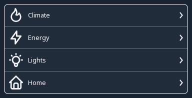

# Controls

The widgets a person can touch: a button, a switch, a slider, a numeric
input and a navigation button, and beside them a checkbox, a dropdown, a
roller, a spinbox, a button matrix, an arc knob, a calendar and a menu.

{: .sb-center}

Everything here writes into a variable. The logic reads that variable and
decides what to do — a button does not start a motor, it sets a bit, and
the program starts the motor. That indirection is what lets the same
screen work on the board and in a browser, and what lets the logic refuse
a command that arrives at the wrong moment.

---

{: .sb-center}

## `button`

| Property | Type | Default | Meaning |
|:---|:---:|:---:|:---:|
| `text` | text | | the label |
| `text_on` | text | | the label while the variable is TRUE |
| `tag` | variable | | what it writes |
| `mode` | `momentary` / `toggle` / `set` / `reset` | | how it writes |
| `value` | number | 1 | the value written |
| `icon` | icon | | a glyph beside the text |
| `confirm` | yes/no | no | ask before acting |
| `confirm_text` | text | | what the question says |

**The mode is the whole widget:**

- **`momentary`** — TRUE while held, FALSE when released. A jog button, a
  horn, anything that should stop when the finger leaves.
- **`toggle`** — each press flips the value. A light, a mode, an
  enable. Give it a **`text_on`** (*text when ON* in the inspector)
  and the caption follows the state: the button says START while the
  drive is off and STOP while it runs, filled with the style's
  accent colour. One widget, honest both ways.
- **`set`** / **`reset`** — a press writes the value and leaves it. Two
  buttons, one to start and one to stop, is often clearer than one that
  toggles: the person can see which state they are asking for.

!!! tip "Use confirm on anything that moves"
    `confirm` is not decoration. Capacitive touch near a frequency drive
    can register presses nobody made, and a sleeve can lean on the glass.
    A dialogue on a command that starts something is the difference
    between electrical noise and an axle turning.

    Write `confirm_text` so it says what will happen — "Start conveyor?"
    beats "Are you sure?".

---

## `switch`

| Property | Type | Default | Meaning |
|:---|:---:|:---:|:---|
| `tag` | variable | | what it writes |
| `label_on` | text | ON | text in the on position |
| `label_off` | text | OFF | text in the off position |
| `bit` | number | −1 | which bit of an integer; −1 = the whole value |

A switch shows its state *and* changes it, which a button cannot. Use it
where the state matters as much as the act of switching: automatic /
manual, enabled / disabled, day / night.

**`bit` is worth knowing about.** Point several switches at the same
integer variable with different bit numbers and you get a row of options
in one variable — one word to send over a fieldbus, one value to store,
one thing for the logic to read. Bits are written atomically, so the
switches never overwrite one another. See [Variables](variables.md).

---

## `slider`

| Property | Type | Default | Meaning |
|:---|:---:|:---:|:---:|
| `tag` | variable | | what it writes |
| `min`, `max` | number | 0, 100 | the range |
| `step` | number | 1 | the increment |

For a value where the *approximate* setting matters and the exact number
does not: brightness, speed, a proportion.

!!! warning "A slider is a poor way to type a number"
    On a 4.3" screen with a gloved finger, a slider spanning 0–100 sets
    values to about five units. Where the number matters — a
    temperature setpoint, a length — use an [`input`](#input) and let the
    person type it.

    A good compromise: a slider for coarse setting with the value shown
    beside it, and buttons for ±1.

`step` also determines how much traffic the slider makes. A step of 0.1
on a range of 0–100 writes a thousand distinct values as a finger
crosses, and every one of them is a change the board redraws and the
browser hears about.

---

## `input`

| Property | Type | Default | Meaning |
|:---|:---:|:---:|:---:|
| `tag` | variable | | what it writes |
| `keypad` | `numeric` / `integer` / `alphanumeric` / `password` | | which keypad opens |
| `min`, `max` | number | | accepted range |
| `title` | text | | shown above the keypad |
| `font` | font | | how the value is drawn |

Touching it opens a keypad on the board — the board's own, not the
operating system's, because a board has no operating system to ask.

**Set `min` and `max`.** They are the only thing standing between a
mistyped digit and a setpoint of 9000. The keypad refuses a value outside
the range and says so, which is far better than accepting it and having
the logic clamp it silently.

The browser keypad of WEBview follows the same rules as the one on the
board: it shows and takes the number in the variable's unit — a `TIME`
in seconds when the variable says seconds — and applies the widget's
limits only when the widget has them.

`title` is worth filling in: a keypad with "Target temperature (°C)" at
the top is unambiguous, one with just a number is a guess.

---

## `nav`

| Property | Type | Meaning |
|:---|:---:|:---:|
| `text` | text | the label |
| `target` | screen | which screen to show |
| `icon` | icon | a glyph beside the text |

Moves between screens. That is all it does — it writes no variable and
the logic never sees it.

!!! tip "Keep navigation in the same place on every screen"
    A row of nav buttons along the bottom, identical everywhere, means
    somebody can move around without reading. Navigation that jumps
    around by screen makes people hunt, and hunting is what they do
    least well when something has gone wrong.

---

## `checkbox`

{: .sb-center}

| Property | Type | Default | Meaning |
|:---|:---:|:---:|:---|
| `tag` | variable | | what it writes |
| `text` | text | | the label beside the box |
| `bit` | number | −1 | which bit of an integer; −1 = the whole value |
| `font` | font | | how the label is drawn |

A box with a tick and a label. A tap toggles the variable, the accent
fills the ticked box. It says the same thing as a [`switch`](#switch) in
less room, and it reads naturally in a column of options: *Eco mode*,
*Porch light*, *Garden light*.

Like the switch, it can own **one bit of an integer**. The two lights in
the picture are bits 0 and 1 of one variable — one word for the logic,
the bus and the recipe, and every box writes only its own bit.

```yaml
- { type: checkbox, rect: [40, 100, 368, 36], tag: eco_mode, text: "Eco mode" }
- { type: checkbox, rect: [40, 142, 368, 36], tag: lamps, bit: 0, text: "Porch light" }
```

---

## `dropdown`

{: .sb-center}

| Property | Type | Default | Meaning |
|:---|:---:|:---:|:---|
| `tag` | variable | | the number of the chosen option |
| `options` | list of texts | | one option per line |
| `font` | font | | how the text is drawn |

The chosen option in a box with an arrow. A tap opens the list **over
the screen** — on the board and in the browser alike — and a pick writes
the option's **number** into the variable: 0 for the first line, 1 for
the second. The logic works with the number; the person reads the words.

Use it where there are more choices than room: a scene, a recipe group,
a language. With two to four options always worth seeing, a
[`button_matrix`](#button_matrix) shows them all at once.

```yaml
- type: dropdown
  rect: [40, 236, 368, 44]
  tag: scene
  options: [Day, Evening, Night, Away]
```

---

## `roller`

{: .sb-center}

| Property | Type | Default | Meaning |
|:---|:---:|:---:|:---|
| `tag` | variable | | the number of the option in the middle row |
| `options` | list of texts | | one option per line |
| `rows` | number | 3 | how many rows are visible (odd, 3 to 9) |
| `font` | font | | how the text is drawn |

A drum of options; **the middle row is the value**, drawn in the accent.
Drag it up or down, or tap the row above or below the middle, and the
option's number is written into the variable.

A roller suits an ordered choice where the neighbours matter — a fan
stage, a speed, an hour — because the person sees what is one step up
and one step down without opening anything.

---

## `spinbox`

{: .sb-center}

| Property | Type | Default | Meaning |
|:---|:---:|:---:|:---|
| `tag` | variable | | what it writes |
| `min`, `max` | number | 0, 100 | the range |
| `step` | number | 1 | how far one tap moves the value |
| `font` | font | | how the value is drawn |

The value between a minus and a plus button. Each tap moves it by
`step` and never past `min` or `max`; a tap on the number itself opens
the keypad for a value further away.

This is the compromise the slider section recommends, in one widget: a
temperature setpoint in steps of 0.5 °C, a count in steps of one — exact,
and without a keypad for the common small change.

```yaml
- { type: spinbox, rect: [640, 130, 184, 50], tag: sp_night, min: 12, max: 24, step: 0.5 }
```

---

## `button_matrix`

{: .sb-center}

| Property | Type | Default | Meaning |
|:---|:---:|:---:|:---|
| `tag` | variable | | the number of the selected button |
| `buttons` | list of texts | | one caption per button |
| `columns` | number | 0 | buttons in a row; 0 = all in one row |
| `font` | font | | how the captions are drawn |

A grid of buttons of which **one is selected** — a segmented control:
Auto / Manual / Off, Day / Evening / Night / Away. A tap writes the
button's number into the variable and the selected one is drawn in the
accent.

It and the dropdown above write the same kind of value, so both can sit
on one variable: the picture's screen has a dropdown and a matrix on the
same scene, and choosing in one moves the other.

```yaml
- type: button_matrix
  rect: [40, 396, 368, 100]
  tag: scene
  buttons: [Day, Evening, Night, Away]
  columns: 2
```

---

## `arc`

{: .sb-center}

| Property | Type | Default | Meaning |
|:---|:---:|:---:|:---|
| `tag` | variable | | what it writes |
| `min`, `max` | number | 0, 100 | the range |
| `start_angle` | degrees | 135 | where the track starts (0 = 3 o'clock, clockwise) |
| `sweep` | degrees | 270 | how long the track is |
| `thickness` | px | 0 | the track's width; 0 = from the size |
| `show_value` | yes/no | yes | the number in the middle |
| `font` | font | | how the number is drawn |

A round knob: a track, the value as an arc in the accent and a handle at
its end. Dragging along the track writes the value; the number sits in
the middle with its unit.

A dimmer, a volume, a valve opening — values a person sets by feel and
reads at a glance. Where the exact number matters more than the feel,
the spinbox is the better tool.

```yaml
- type: arc
  rect: [966, 96, 180, 180]
  tag: dimmer
  min: 0
  max: 100
  thickness: 16
```

---

## `calendar`

{: .sb-center}

| Property | Type | Default | Meaning |
|:---|:---:|:---:|:---|
| `tag` | variable | | the date as a number YYYYMMDD |
| `font` | font | | how the days are drawn |

A month. The variable holds a date written as one number, `20261016`;
its day is drawn in the accent, a tap on another day writes that day,
and the arrows in the header page through the months.

Give it a `DINT` variable. A program reads the date with plain
arithmetic — the year is `day / 10000`, the month `day / 100 MOD 100` —
and a holiday, a service date or the first day of a heating plan is one
comparison away.

!!! note "Today's circle"
    The day ringed in the calendar is today's date from the board's clock,
    so a board with network time shows the real day.

---

## `menu`

{: .sb-center}

| Property | Type | Default | Meaning |
|:---|:---:|:---:|:---|
| `tag` | variable | | written by the rows that carry a value |
| `items` | list | | the rows |
| `row_height` | px | 40 | the height of one row |
| `font` | font | | how the text is drawn |

Rows of text, each with an optional icon and an arrow. A row is one of
two things:

- a row with a **`target`** opens that screen — a list of places, the
  way a phone's settings page is a list;
- a row with a **`value`** writes it into the menu's variable and is
  drawn selected while the variable holds it — a list of modes.

| Row key | Meaning |
|:---|:---|
| `text` | what the row says |
| `icon` | a glyph at its left |
| `target` | the screen it opens |
| `value` | the number it writes |

```yaml
- type: menu
  rect: [40, 512, 368, 180]
  row_height: 45
  items:
    - { text: "Climate", icon: flame, target: climate }
    - { text: "Energy", icon: bolt, target: energy }
    - { text: "Home", icon: home, target: home }
```

---

## `wheel`

{: .sb-center}

| Property | Type | Default | Meaning |
|:---|:---:|:---:|:---|
| `tag` | variable | | the selected item's value, written as the ring turns |
| `items` | list | | the icons on the ring (the `menu`'s rows) |
| `icon_size` | px | 40 | the size of one icon |
| `font` | font | | the caption in the centre |

A ring of icons with their captions — the home screen of a round glass
with a knob. The **selected item sits at the top**, the ring turns to
bring the next one there, and the selected item's caption is drawn in the
centre. The items are the menu's rows: a `text`, an `icon`, a `target`
screen and an optional `value`.

Three gestures, the same on the glass and in the browser:

- **turning** the knob, dragging a finger along the ring or tapping an
  icon **selects** — the item's `value` (its position when it has none)
  is written to the variable at once, so the program sees the selection
  live;
- **pressing** the knob, tapping the centre or tapping the selected icon
  a second time **activates** — an item with a `target` opens that
  screen.

Four to eight items read well; sixteen is the limit. The wheel takes the
knob's turns directly while it has the focus — it is the thing being
turned.

```yaml
- type: wheel
  rect: [0, 0, 240, 240]
  tag: page
  icon_size: 40
  items:
    - { text: "Heating", icon: flame, target: heating }
    - { text: "Light", icon: bulb, target: light }
    - { text: "Fan", icon: propeller, target: fan }
    - { text: "Setup", icon: settings, target: setup }
```

---

## The knob

A panel with an encoder around its glass is driven without a finger. The
project names the encoder (one of its `encoders:`) and, when the encoder
has one, its push button — a BOOL variable:

```yaml
encoders:
  - { name: knob, a: 40, b: 41, mode: x4, position_tag: knob_pos }
knob: { encoder: knob, button: knob_btn, steps: 4 }
```

From then on the glass behaves the way an encoder-driven interface is
expected to:

- a **turn moves the focus** between the screen's controls in drawing
  order, wrapping at the end — the focused control wears a ring in its
  accent colour;
- a **press on a button**, a switch, a checkbox or a navigation button
  acts, exactly as a tap would;
- a **press on a value widget** — a slider, an arc, a roller, a spinbox,
  a dropdown, a menu, a tileview, a calendar — enters **edit**: the ring
  becomes solid and a turn changes the value (a slider or an arc walks
  its range in fifty steps, a spinbox by its step, a list by one
  option); a second press leaves edit;
- a **long press** leaves edit, or, with nothing in edit, opens the
  project's first screen — the way home;
- a `wheel` takes the turns itself and a press activates its selected
  item.

A screen with a single control starts with it focused, so a page that is
one arc turns at once. A tap on the glass moves the focus to what it
touched; touch and knob live together. `steps` is the number of encoder
counts per detent (4 = one quadrature cycle), `invert` turns the
direction round.

The browser follows the same rules from the keyboard: the arrow keys
turn, Enter presses, Escape is the long press.

---

## What controls do not do

A control never acts directly on an output. It writes a variable; the
logic decides.

That sounds like an extra step and it is the reason the same screen works
in a browser, the reason a command can be refused while the equipment is in
the wrong state, and the reason you can test every screen in simulation
without anything being wired up at all.
