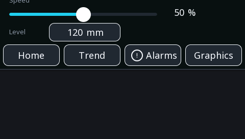

# Controls

Five widgets a person can touch: a button, a switch, a slider, a numeric
input and a navigation button.

Everything here writes into a variable. The logic reads that variable and
decides what to do — a button does not start a motor, it sets a bit, and
the program starts the motor. That indirection is what lets the same
screen work on the board and in a browser, and what lets the logic refuse
a command that arrives at the wrong moment.

---

{: .sb-center}

## `button`

| Property | Type | Default | Meaning |
|:---|:---:|:---:|:---:|
| `text` | text | | the label |
| `text_on` | text | | the label while the variable is TRUE |
| `tag` | variable | | what it writes |
| `mode` | `momentary` / `toggle` / `set` / `reset` | | how it writes |
| `value` | number | 1 | the value written |
| `icon` | icon | | a glyph beside the text |
| `confirm` | yes/no | no | ask before acting |
| `confirm_text` | text | | what the question says |

**The mode is the whole widget:**

- **`momentary`** — TRUE while held, FALSE when released. A jog button, a
  horn, anything that should stop when the finger leaves.
- **`toggle`** — each press flips the value. A light, a mode, an
  enable. Give it a **`text_on`** (*text when ON* in the inspector)
  and the caption follows the state: the button says START while the
  drive is off and STOP while it runs, filled with the style's
  accent colour. One widget, honest both ways.
- **`set`** / **`reset`** — a press writes the value and leaves it. Two
  buttons, one to start and one to stop, is often clearer than one that
  toggles: the person can see which state they are asking for.

!!! tip "Use confirm on anything that moves"
    `confirm` is not decoration. Capacitive touch near a frequency drive
    can register presses nobody made, and a sleeve can lean on the glass.
    A dialogue on a command that starts something is the difference
    between electrical noise and an axle turning.

    Write `confirm_text` so it says what will happen — "Start conveyor?"
    beats "Are you sure?".

---

## `switch`

| Property | Type | Default | Meaning |
|:---|:---:|:---:|:---|
| `tag` | variable | | what it writes |
| `label_on` | text | ON | text in the on position |
| `label_off` | text | OFF | text in the off position |
| `bit` | number | −1 | which bit of an integer; −1 = the whole value |

A switch shows its state *and* changes it, which a button cannot. Use it
where the state matters as much as the act of switching: automatic /
manual, enabled / disabled, day / night.

**`bit` is worth knowing about.** Point several switches at the same
integer variable with different bit numbers and you get a row of options
in one variable — one word to send over a fieldbus, one value to store,
one thing for the logic to read. Bits are written atomically, so the
switches never overwrite one another. See [Variables](variables.md).

---

## `slider`

| Property | Type | Default | Meaning |
|:---|:---:|:---:|:---:|
| `tag` | variable | | what it writes |
| `min`, `max` | number | 0, 100 | the range |
| `step` | number | 1 | the increment |

For a value where the *approximate* setting matters and the exact number
does not: brightness, speed, a proportion.

!!! warning "A slider is a poor way to type a number"
    On a 4.3" screen with a gloved finger, a slider spanning 0–100 sets
    values to about five units. Where the number matters — a
    temperature setpoint, a length — use an [`input`](#input) and let the
    person type it.

    A good compromise: a slider for coarse setting with the value shown
    beside it, and buttons for ±1.

`step` also determines how much traffic the slider makes. A step of 0.1
on a range of 0–100 writes a thousand distinct values as a finger
crosses, and every one of them is a change the board redraws and the
browser hears about.

---

## `input`

| Property | Type | Default | Meaning |
|:---|:---:|:---:|:---:|
| `tag` | variable | | what it writes |
| `keypad` | `numeric` / `integer` / `alphanumeric` / `password` | | which keypad opens |
| `min`, `max` | number | | accepted range |
| `title` | text | | shown above the keypad |
| `font` | font | | how the value is drawn |

Touching it opens a keypad on the board — the board's own, not the
operating system's, because a board has no operating system to ask.

**Set `min` and `max`.** They are the only thing standing between a
mistyped digit and a setpoint of 9000. The keypad refuses a value outside
the range and says so, which is far better than accepting it and having
the logic clamp it silently.

The browser keypad of WEBview follows the same rules as the one on the
board: it shows and takes the number in the variable's unit — a `TIME`
in seconds when the variable says seconds — and applies the widget's
limits only when the widget has them.

`title` is worth filling in: a keypad with "Target temperature (°C)" at
the top is unambiguous, one with just a number is a guess.

---

## `nav`

| Property | Type | Meaning |
|:---|:---:|:---:|
| `text` | text | the label |
| `target` | screen | which screen to show |
| `icon` | icon | a glyph beside the text |

Moves between screens. That is all it does — it writes no variable and
the logic never sees it.

!!! tip "Keep navigation in the same place on every screen"
    A row of nav buttons along the bottom, identical everywhere, means
    somebody can move around without reading. Navigation that jumps
    around by screen makes people hunt, and hunting is what they do
    least well when something has gone wrong.

---

## What controls do not do

A control never acts directly on an output. It writes a variable; the
logic decides.

That sounds like an extra step and it is the reason the same screen works
in a browser, the reason a command can be refused while the equipment is in
the wrong state, and the reason you can test every screen in simulation
without anything being wired up at all.
