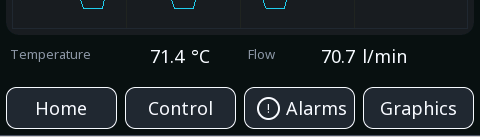
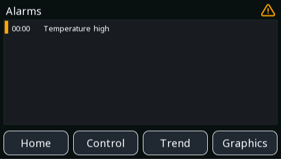

# Trends and alarms

Three widgets that show history rather than the present moment: a trend
chart, the traces inside it, and the alarm table.

These are the widgets somebody opens when they want to know **why**, not
**what** — and a screen that can answer that question saves the walk back
to the office for a laptop.

---

{: .sb-center}

## `trend`

| Property | Type | Default | Meaning |
|:---|:---:|:---:|:---|
| `series` | list | | the traces (see below) |
| `timespan_s` | number | 300 | how much time is shown, seconds |
| `sample_ms` | number | 1000 | how often a point is taken |
| `autoscale` | yes/no | yes | fit the vertical axis to the data |
| `min`, `max` | number | | fixed axis when autoscale is off |
| `grid` | yes/no | yes | draw gridlines |
| `show_legend` | yes/no | yes | name the traces |
| `scroll_mode` | yes/no | yes | scroll, rather than wrap around |

A chart of how values have behaved. Up to **four traces**, sampled in the
board — so the history exists whether or not anybody is watching.

**`timespan_s` and `sample_ms` together decide what you can see.** Five
minutes at one second per point is 300 points, which is about the width
of a panel screen — sensible. Five minutes at 10 ms per point is 30 000
points squeezed into a few hundred pixels, and everything short is lost
in the squeeze anyway.

**Autoscale is right for watching and wrong for comparing.** With it on,
a flat line fills the chart and looks dramatic; with a fixed `min`/`max`,
flat looks flat and two screens of the same variable can be compared.
Fix the axis for anything somebody will judge by eye.

!!! tip "For anything short, use the Scope"
    A trend samples periodically. A pulse one cycle long falls between
    two samples by construction — and the fault you are chasing is
    usually exactly that. The [Scope](scope.md) records **every cycle**
    in the board and stops on a trigger. Trend for behaviour over
    minutes, scope for what happened in one.

---

## `trace`

| Property | Type | Meaning |
|:---|:---:|:---:|
| `tag` | variable | what this line follows |
| `color` | colour | how it is drawn |

One line in a trend. Traces are children of the trend widget — you do not
place them on the screen yourself.

**Give traces colours that survive being printed and photographed.**
Somebody will screenshot the board and send it to you, and two similar
blues become one blue in the process.

---

## `alarm_table`

{: .sb-center}

| Property | Type | Default | Meaning |
|:---|:---:|:---:|:---:|
| `filter` | `active` / `unacked` / `history` / `all` | | which alarms to show |
| `min_priority` | `info` / `warning` / `fault` / `critical` | | the lowest priority shown |
| `rows` | number | 8 | how many fit |
| `show_time` | yes/no | yes | when it happened |
| `show_ack_button` | yes/no | yes | let the reader acknowledge |
| `sort` | `newest_first` / `priority` | newest_first | ordering |
| `font` | font | | text size |

The list of what is wrong, and what was.

**`filter` decides what the table is for**, and it is worth having more
than one:

- **`active`** — what is wrong *now*. The screen somebody looks at when
  something has stopped.
- **`unacked`** — what has not been seen yet, including things that have
  already cleared. This is the one that catches the intermittent fault
  nobody was standing there for.
- **`history`** — what happened, in order. The answer to "it did
  something odd this morning".

**`sort` by priority when the table is short.** With eight rows and a
busy alarm situation, newest-first can push the critical one off the
bottom while a stream of information messages fills the view.

!!! tip "Timestamps are only as good as the clock"
    An alarm history with no time is a list of things that happened in an
    unknown order. Make sure the board's clock is set — from the network,
    from an RTC, or from the browser — **before** commissioning, not
    after. Otherwise the first day's history is stamped in 1970.

---

## Where the history lives

Both widgets read data the **board** collects, in the board, all the
time. Nothing depends on a browser being open or an editor being
connected.

That is what makes them worth putting on a screen: the equipment
remembers, so the person who arrives afterwards can find out what
happened without having been there.
