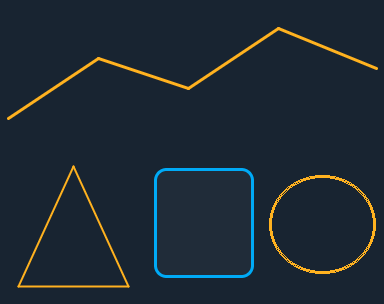
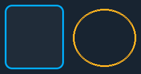

# Images and icons

The widgets that draw pictures: an image, an icon and the ctrl32 mark, a
line, a shape and an animated image.

---

{: .sb-center}

## `icon`

| Property | Type | Meaning |
|:---|:---:|:---|
| `src` | icon | which glyph |
| `color` | colour | how it is drawn |
| `tag` | variable | switches between the two states below |
| `src_active` | icon | the glyph when the variable is true |
| `color_active` | colour | the colour when it is true |

The one to reach for first. Icons are **vector outlines**, so they are
sharp at any size — a 16-pixel status glyph and a screen-filling symbol
come from the same entry and neither is blocky.

They also cost almost nothing: an outline is tens of bytes, where a
bitmap of the same picture grows with the square of its size. A
full-screen bitmap icon used to cost a couple of hundred kilobytes.

**With `tag`, one icon says two things.** A pump that changes glyph *and*
colour when it runs, a valve that shows open and shut, a lock that
locks — one widget, no hidden twin, nothing to keep in step.

!!! tip "Icons are drawn identically everywhere"
    The board, the editor canvas and the browser all fill the same
    outlines, so what you place is what appears — including in a
    screenshot somebody sends you from the field.

---

## `image`

| Property | Type | Meaning |
|:---|:---:|:---:|
| `src` | image | which picture |
| `tint` | colour | recolour it |

A bitmap from the project's assets: a logo, a photograph, a diagram of
the thing being controlled.

**An image is a picture, and pictures are large.** It is baked into the
project file at the size it is shown, so a full-screen photograph is a
serious part of the upload and of the board's flash. Check what it costs
before deciding a screen needs one.

Use images for what only a picture can say — a diagram with the sensors
marked on it, a photograph of the part being handled. For symbols, an
[icon](#icon) is smaller, sharper and recolourable.

!!! tip "A layout diagram beats a paragraph"
    One drawing of the equipment with the lamps placed where the real
    sensors are tells somebody more in a second than a table of names
    does in a minute — especially somebody who has never seen it before.

---

## `logo`

| Property | Type | Meaning |
|:---|:---:|:---:|
| `color` | colour | how it is drawn |

The ctrl32 mark, drawn as vectors — sharp at any size, one colour.

Useful on a start screen or in a corner. Nobody has to use it, and a
screen is not more or less legitimate for having it.

---

## `line`

{: .sb-center}

| Property | Type | Default | Meaning |
|:---|:---:|:---:|:---|
| `points` | list of x, y | | the corners, in the widget's own frame |
| `width` | px | 2 | how thick it is |
| `closed` | yes/no | no | join the last point to the first |

A line through its points in the fg colour, smoothed at the edges. A
pipe on a process picture, an arrow, a fixed profile drawn behind a live
value, a triangle — `closed` turns the line into an outline.

The points are relative to the widget's rectangle, so moving the widget
moves the drawing with it.

```yaml
- type: line
  rect: [40, 400, 368, 130]
  points: [[0, 110], [90, 50], [180, 80], [270, 20], [368, 60]]
  width: 3
```

---

## `shape`

{: .sb-center}

| Property | Type | Default | Meaning |
|:---|:---:|:---:|:---|
| `shape` | `rect` / `ellipse` | rect | what it draws |
| `fill` | yes/no | yes | fill it with bg |
| `border_width` | px | 1 | the outline, in fg |
| `radius` | px | 0 | rounded corners of a rectangle |

A rectangle or an ellipse that fills the widget. A tank, a frame round a
group, a lamp drawn the size of the real one, a ring.

Shapes with [states](states-motion.md) are cheap animation: a shape
that changes colour with a variable is a running motor on a mimic
diagram without a single picture in the project.

---

## `anim_image`

{: .sb-center}

| Property | Type | Default | Meaning |
|:---|:---:|:---:|:---|
| `frames` | list of images | | the pictures, in order |
| `tag` | variable | | picks the frame by its value |
| `period_ms` | ms | 500 | how long each frame shows |

A picture made of frames — images of the project. It works two ways:

- **without a variable** it shows the frames one after another, each for
  `period_ms` — a turning fan, a blinking warning;
- **with a variable** the value picks the frame (0 = the first): a motor
  drawn stopped, running or faulted, one picture per state.

In the picture the frames are two drawings of the same fan turned by
45°, with no variable — so it turns. To turn it only while a drive runs,
give it `visible_if` with the drive's *running* variable and lay a still
image of the fan under it.

```yaml
- { type: anim_image, rect: [1090, 210, 96, 96], frames: [fan0, fan1], period_ms: 250 }
```

---

## Colour and tint

`color` on an icon and `tint` on an image both recolour what is drawn.
The practical use is **one asset, several meanings**: the same warning
triangle in amber for a warning and red for a fault, without a second
file.

Combined with [states](widgets.md), the colour can follow a variable —
so a single icon covers running, stopped and faulty from one definition.

!!! warning "A #RRGGBB colour used to come out black"
    If you have an older project where an icon renders in the style
    colour rather than the one you chose, this is why: the web-style
    `"#F5A623"` spelling was not parsed and silently yielded black. Both
    spellings work now. Re-check any colour that never looked right.
