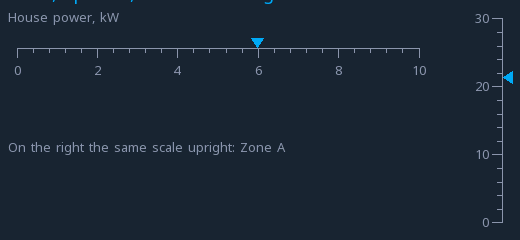

# Indicators

The widgets that show a value without letting anyone change it: a lamp,
a bar and a gauge, and beside them a table, a scale, a spinner and a QR
code.

They are what somebody reads from across the room, so the question with
each is not "does it show the value" but "can it be understood in half a
second, by somebody who is not looking carefully".

---

{: .sb-center}

## `led`

| Property | Type | Default | Meaning |
|:---|:---:|:---:|:---|
| `shape` | `round` / `rect` | round | how it is drawn |
| `tag` | variable | | what it follows |
| `color_on` | colour | | when the value is true |
| `color_off` | colour | | when it is not |
| `blink_hz` | number | 0 | blink rate; 0 = steady |
| `bit` | number | −1 | which bit of an integer; −1 = the whole value |

The workhorse of any screen. One variable, two colours, immediately
readable.

**`bit` turns one integer into a row of lamps.** A status word from a
drive, a mask the logic builds, a set of flags — point four lamps at the
same variable with bits 0 to 3 and the whole word is visible at once.

**`blink_hz` earns its place on things that need attention.** A steady
red lamp and a blinking red lamp say different things, and people read
the difference without being taught. Use blinking for "unacknowledged",
steady for "still present".

!!! tip "Three states are better than two"
    A lamp does not have to be limited to on and off. With
    [states](widgets.md) it takes a true, a false **and** an alarm
    colour, driven by a variable or by one bit — so one widget says
    running, stopped, or faulty, instead of two widgets and a hidden
    one.

---

## `bar`

| Property | Type | Default | Meaning |
|:---|:---:|:---:|:---:|
| `tag` | variable | | the value |
| `min`, `max` | number | 0, 100 | the range it spans |
| `orientation` | `vertical` / `horizontal` | | which way it fills |

A proportion, at a glance. Tank level, load, progress, how far through a
delay.

The strength of a bar is that it shows **where the value sits in its
range** without anybody doing arithmetic. "Forty-two" means nothing on
its own; a bar four-tenths full means something immediately.

!!! tip "Set min and max to what matters, not to what is possible"
    A pressure sensor may read 0–16 bar while the interesting range is
    4–6. A bar spanning the full sensor range is a bar that never moves.
    Span the range you care about and let it clip.

**Vertical bars read as level; horizontal ones read as progress.** It is
a small thing and it is worth following, because people bring the
expectation with them.

---

## `gauge`

| Property | Type | Default | Meaning |
|:---|:---:|:---:|:---:|
| `tag` | variable | | the value |
| `min`, `max` | number | 0, 100 | the range |
| `start_angle` | number | 135 | where the scale begins, degrees |
| `sweep` | number | 270 | how far it goes round |
| `thickness` | number | 0 | ring thickness; 0 = automatic |
| `needle` | yes/no | yes | draw a needle |
| `show_value` | yes/no | yes | the number in the centre |
| `cache_background` | yes/no | yes | precompute the dial |

The dial. Slower to read than a bar and better at one thing: a person who
knows the equipment recognises the *position* of the needle without reading
the number at all.

**Leave `cache_background` on.** The dial — the ring, the ticks, the
gradient — is expensive to draw and never changes, so it is rendered once
at startup and reused. Turning the cache off means drawing it on every
update, and on a busy screen that is felt.

**`needle` off gives you a ring** instead: a filled arc with the value in
the middle. Cleaner, more modern, and easier to read at small sizes. The
needle is better when somebody watches for the value to move.

**The centre number is optional** (*Center number* in the inspector).
On small glass it often crowds the dial — switch it off and let the
position speak, or place a separate `value` widget where the number
reads best. The dial in the i550 example does exactly that.

The default 135° start with a 270° sweep is the familiar shape — bottom
left, round the top, bottom right. Changing them gives you a half dial
(start 180, sweep 180) or a quarter.

---

## `table`

{: .sb-center}

| Property | Type | Default | Meaning |
|:---|:---:|:---:|:---|
| `header` | text | | the first row, cells separated by `\|` |
| `rows` | list | | the rows |
| `font` | font | | how the cells are drawn |

Rows of cells, the header drawn in the accent. A row is its `cells` —
one text with the cells separated by a vertical bar, or a list — and a
row with a variable shows the variable's live value **with its unit** as
its last cell, right-aligned like numbers in a printed table.

| Row key | Meaning |
|:---|:---|
| `cells` | the row's fixed cells |
| `tag` | a variable whose value is the last cell |

Several values that belong together — the rooms of a house, the axes of
a gantry, the zones of an oven — read faster as a table than as the same
number of separate value widgets, and cost one widget instead of ten.

```yaml
- type: table
  rect: [40, 100, 468, 224]
  header: "Place|Value"
  rows:
    - { cells: "Zone A", tag: temp_a }
    - { cells: "Outside", tag: out_temp }
    - { cells: [Note, "steady"] }
```

---

## `scale`

{: .sb-center}

| Property | Type | Default | Meaning |
|:---|:---:|:---:|:---|
| `tag` | variable | | where the pointer sits |
| `min`, `max` | number | 0, 100 | the range |
| `major` | number | 5 | numbered ticks |
| `minor` | number | 4 | ticks between two numbered ones |
| `orientation` | `horizontal` / `vertical` | horizontal | how it lies |
| `font` | font | | how the numbers are drawn |

A straight scale with numbered and small ticks. With a variable a
pointer in the accent shows where the value sits on it.

A scale is what a [`bar`](#bar) is missing when the position matters
more than the fill: a pressure against its working range, a level
against its marks. Laid upright beside a tank picture, it reads like the
sight glass on the real one.

---

## `spinner`

{: .sb-center}

| Property | Type | Default | Meaning |
|:---|:---:|:---:|:---|
| `tag` | variable | | turns only while it is true |
| `period_ms` | ms | 1000 | one turn |
| `thickness` | px | 0 | the arc's width; 0 = from the size |

A turning arc that says *wait* or *busy*. With a variable it turns only
while the variable is true and shows just its track otherwise — a homing
run, a recipe being written, a drive ramping up.

---

## `qrcode`

{: .sb-center}

| Property | Type | Default | Meaning |
|:---|:---:|:---:|:---|
| `text` | text | | what the code carries |

A QR code of `text`, as large as the widget allows, drawn in fg on bg —
keep them dark on light, the way every phone camera expects.

The obvious use is the board's own address: a phone pointed at the
panel opens the same screens in its browser. A link to the manual, a
service form or the WiFi login of a guest network are the others.

```yaml
- { type: qrcode, rect: [872, 396, 150, 150], text: "http://192.168.0.172/" }
```

---

## Choosing between them

| The question is | Use |
|:---|:---:|
| is it on? | **led** |
| how full, how far, how much of the way | **bar** |
| what is the value, roughly, at a glance | **gauge** |
| what is the value, exactly | a [`value`](widgets-text.md) widget |

And the honest answer is often the last one. A number in a large font is
the fastest thing to read on any screen — gauges and bars earn their
place when the *position within a range* matters more than the digits.

---

## What makes indicators expensive

An indicator redraws when its variable changes. An analog variable
without a deadband changes on every flicker of its last digit, so a
gauge bound to one repaints continuously and never sits still.

Set a deadband on the variable, not on the widget. Everything reading it
gets quieter at once — the board, the trend, the browser. See
[Variables](variables.md).
