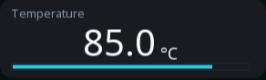
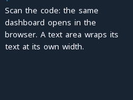
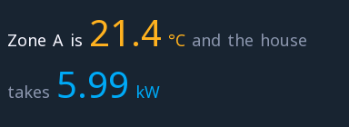

# Text and values

Four widgets: one draws fixed text, one a number that changes, one a
paragraph that wraps and one a sentence of mixed colours and live values.

Between them they carry most of what a screen actually says, and the
number widget is the fastest thing on any screen to read — worth
remembering before reaching for a gauge.

---

{: .sb-center}

## `label`

| Property | Type | Default | Meaning |
|:---|:---:|:---:|:---:|
| `text` | text | | what it says |
| `font` | font | | which face and size |
| `align` | `left` / `center` / `right` | left | within its rectangle |
| `valign` | `top` / `center` / `bottom` | top | where the line sits in the rectangle's height |

Fixed text: a heading, a unit, a name beside a lamp, an instruction.

**Alignment matters more than it looks.** A column of labels aligned
right against a column of values aligned left reads as a table, and the
eye follows it without effort. The same labels aligned left produce a
ragged gap between name and number that the reader has to cross every
time.

**A label beside a value.** A value always sits in the middle of its
rectangle's height. Give the label next to it `valign: center` and the
same height, and the two lines stand on one baseline.

!!! warning "Check your language's accented characters early"
    A font baked without the right character range drops accents
    silently — the text renders, just without the marks, and it is the
    kind of thing nobody notices in the editor and everybody notices on
    the board. Put one label with your worst-case word on a test screen
    and look at it on the glass.

---

## `value`

| Property | Type | Default | Meaning |
|:---|:---:|:---:|:---:|
| `tag` | variable | | what it shows |
| `font` | font | | which face and size |
| `show_unit` | yes/no | yes | append the variable's unit |
| `warn_above` | number | | draw differently above this |
| `warn_color` | colour | | the colour to use then |

A number, live. The decimals and the unit come from the **variable**, not
from the widget — set them once in the variable table and every screen
showing it agrees.

**`warn_above` is the cheapest alarm on any screen.** A temperature that
turns amber past 80 needs no alarm definition, no acknowledgement and no
extra widget — and it is read from across the room by somebody who is not
looking for it.

Use it for the soft limit, and a real [alarm](widgets-data.md) for the
hard one. Together they give a warning stage and an action stage.

!!! tip "Make the important number bigger than feels sensible"
    A screen with one number in a large font and everything else small is
    readable from a distance and instantly tells the reader what this
    screen is *about*. Five numbers of the same size is a screen with no
    subject.

---

## `textarea`

{: .sb-center}

| Property | Type | Default | Meaning |
|:---|:---:|:---:|:---|
| `text` | text | | what it shows |
| `tag` | variable | | a text (`STRING`) variable to show instead |
| `editable` | yes/no | no | a tap opens the keyboard |
| `align` | `left` / `center` / `right` | left | how each line sits |
| `font` | font | | how the text is drawn |

Text over several lines, **wrapped at the widget's width** — a word that
does not fit starts the next line, and a new line in the text starts a
new line on the screen. An instruction next to a control, a note on a
service page, a paragraph a [`label`](#label) would cut off.

On a Linux device it can show a text (`STRING`) variable instead of its
fixed text, and with `editable` a tap opens the keyboard: a note the
shift leaves for the next one, a batch comment, a reason for a stop.

```yaml
- type: textarea
  rect: [1036, 396, 204, 150]
  text: "Scan the code: the same dashboard opens in the browser."
```

---

## `rich_text`

{: .sb-center}

| Property | Type | Default | Meaning |
|:---|:---:|:---:|:---|
| `spans` | list | | the pieces of the paragraph |

One paragraph made of **spans**, each with its own colour and font — a
word in red, a value in a large face — flowing on and wrapping at the
widget's width. A span with a variable shows its live value with the
unit.

| Span key | Meaning |
|:---|:---|
| `text` | the span's words |
| `tag` | a variable whose value follows the words |
| `color` | its colour |
| `font` | its font |

The spans join exactly as written: put the space between two spans
where you want one. A value in the large numeric face carries its unit
in the medium face beside it, the way the [`value`](#value) widget sets
it.

```yaml
- type: rich_text
  rect: [872, 566, 368, 124]
  spans:
    - { text: "Zone A is ", color: 0xF7BF, font: 1 }
    - { text: "", tag: temp_a, color: 0xFD84, font: 2 }
    - { text: " and the house takes ", color: 0x8CB5, font: 1 }
    - { text: "", tag: house_power, color: 0x055E, font: 2 }
```

---

## Where the decimals come from

Both widgets draw what the variable says. A variable with two decimals
and unit `bar` shows `4.25 bar` on the board, in the browser and in a
trend legend — no per-widget formatting, no disagreement between two
screens showing the same thing.

The corollary: if a value shows too many digits, fix the **variable**.
`show_unit` exists for the case where the unit is already in a label
beside it and repeating it would be noise.

---

## Deadband, again

A number without a deadband on its variable repaints on every flicker of
the last digit — and a value that will not sit still is harder to read
than one that updates twice a second.

Deadband is a property of the variable, so setting it quiets the screen,
the browser and the trend at once. See [Variables](variables.md).
