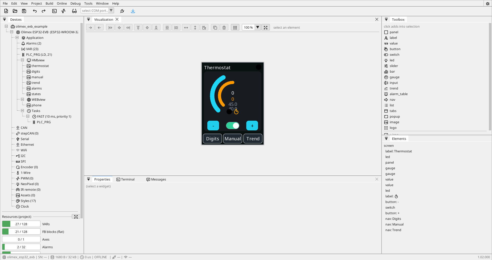

# ctrl32

ctrl32 is an editor and a family of runtimes for automation on ESP32 and
STM32 boards and on Linux devices. In the editor you draw the screens,
define the variables, write the logic in [ladder](/docs/programming/ladder/),
[FBD](/docs/programming/fbd-composites/) or [Structured Text](/docs/programming/st-language/), and
download the project to the device. The same screens also run in a
browser.

!!! warning "Read before you plan anything with it"
    ctrl32 carries **no certification of any kind** - no CE marking for a
    finished product, no functional-safety rating, no type approval. It
    does not belong in an installation where people's safety, other
    people's property or an insurer's opinion depends on it. See
    [Intended use](/docs/about/intended-use/).

!!! danger "Never route safety through the device"
    Emergency stop, guards, light curtains and limit switches are
    **hard-wired**, always. Stopping a drive over CANopen or EtherCAT is
    not a safety function - that is what a drive's STO terminals are for.
    ctrl32 is not a real-time system: it holds a 10-20 ms cycle
    dependably, with jitter from the network stack.

{: .sb-center}

## Start

-   **Raspberry Pi**

    ---

    From a blank card to the runtime running your project.

    [Raspberry Pi](/docs/getting-started/setup-raspberry-pi/)

-   **ESP32**

    ---

    From the box to a running program, over USB and over the network.

    [ESP32](/docs/getting-started/setup-esp32/)

-   **STM32**

    ---

    The STM32F746G-DISCO through its ST-LINK cable.

    [STM32](/docs/getting-started/setup-stm32/)

-   **When something does not work**

    ---

    The messages the system prints, and what is behind them.

    [Troubleshooting](/docs/operation/troubleshooting/)

## What it is made of

| Part | What it does |
|:---|:---|
| **Editor** | the installed desktop application - screens, variables, programs, download, online monitoring |
| **Runtime** | the firmware of an ESP32 or STM32 board: draws [HMIview](/docs/visualisation/hmiview/) on the display, runs the program, talks Modbus, CAN and the other buses |
| **Linux runtime** | the same engines on a Raspberry Pi or another Linux device, with larger limits and OPC UA - [The Linux runtime](/docs/hardware/linux-runtime/) |
| **WEBview** | the same screens in a browser, served by the device - [WEBview](/docs/visualisation/webview/) |
| **net32** | several ctrl32 devices sharing variables as one system - [net32](/docs/buses/net32/) |

## The screens are data, not code

The editor builds the project into a pack - screens, variables, programs
- and the device reads it straight from flash. Changing a screen is a
download, not a reflash of the device. The device keeps two program slots:
a new pack is verified before it becomes active, and a failed download
leaves the old one running. See [Download to the board](/docs/deployment/deploy/).

The editor draws with the same code as the device, so the canvas shows
exactly what the device will show.

## Where things are

| You want to | Go to |
|:---|:---|
| know the editor's windows, menus and keys | [Editor](/docs/editor-overview/) |
| declare variables | [Variables](/docs/editor-overview/variables/) |
| draw screens | [Visualisation](/docs/visualisation/) |
| write the program | [Programming](/docs/programming/) |
| look up a block | [Function blocks](/docs/blocks/) |
| connect a bus or a protocol | [Protocols](/docs/buses/) |
| wire a chip | [Chips and services](/docs/peripherals-and-services/) |
| put it on a device | [Deployment](/docs/deployment/) |
| watch, force, trace it running | [Operation](/docs/operation/) |
| know the limits | [Performance and limits](/docs/operation/limits/) |
